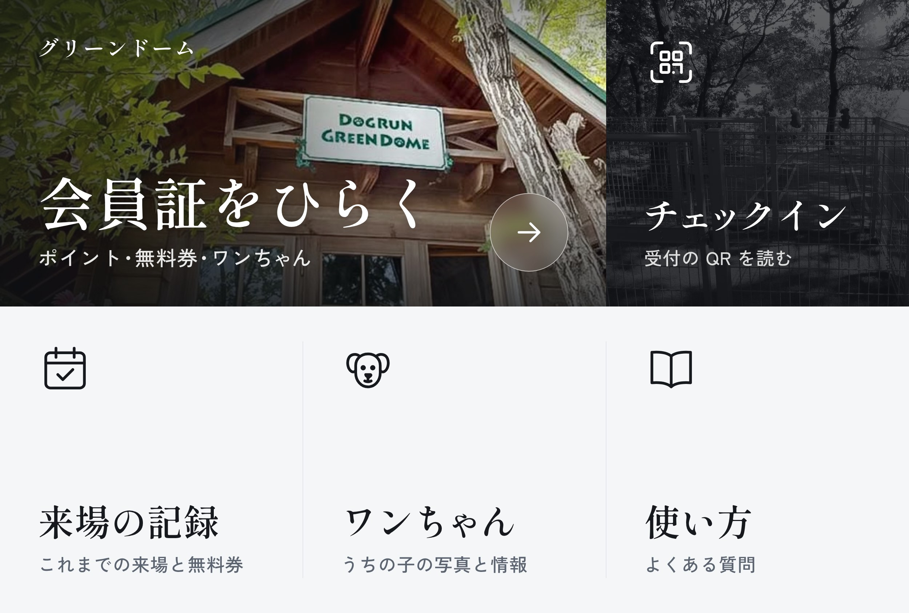

# LINE 公式アカウントのリッチメニュー

トーク画面の下に、会員証・チェックイン・来場の記録・ワンちゃん・使い方を常に出す。押すと LINE の中で会員証(LIFF)が開く。



- 画像: `docs/line/richmenu.jpg`(2500×1686、大きいサイズ、1MB 以下。いまは 460KB ほど)。施設の写真(`docs/line/photos/`)を使っている。
- LIFF ID: `2012268866-TDSM6zyj`

## デザインの案(3 つ)

いま使っているのは「雑誌」の案。ほかの 2 つは `docs/line/alt/` にあり、どれも押せる場所(下の 6 マス)は同じなので、画像を差し替えるだけで使える。

| 案 | 画像 | 元の HTML | ねらい |
| --- | --- | --- | --- |
| 雑誌(いま使っている) | `richmenu.jpg` | `richmenu.html` | 小屋の写真を大きく、明朝体の見出し。下の段は明るいグレーの面を細い罫線で区切り、線のアイコンと言葉だけ。落ち着いて上品 |
| 夜 | `alt/dark.jpg` | `alt/dark.html` | 墨色の下地にすりガラスのカード。トーク画面の中でいちばん目立つ |
| ぬくもり | `alt/warm.jpg` | `alt/warm.html` | 丸みのある文字と白いカード。親しみやすい |

- **案を差し替える**: 下の手順 6 で、`richmenu.jpg` の代わりに `alt/dark.jpg` か `alt/warm.jpg` を選ぶ。押せる場所の設定(手順 7)は変えなくてよい。デモ(`apps/demo/src/assets/richmenu.jpg`)も同じ画像に置き換える。
- **作り直す**: HTML を直して、リポジトリの直下で次を実行する。文字は Google Fonts を使うので、インターネットにつながった状態で行う(読み込めないときは止まる)。容量は自動で 800KB 以下に収める。

  ```sh
  node docs/line/make-richmenu.mjs            # いまの案(richmenu.jpg)
  node docs/line/make-richmenu.mjs dark       # ほかの案(alt/dark.jpg)
  node docs/line/make-richmenu.mjs --all      # すべて
  node docs/line/make-richmenu.mjs --grid     # 6 マスの区切り線を重ねた確認用の画像も作る(一時フォルダ)
  ```

- **作るときの決まり**: 2500×1686 の JPEG で 1MB 以下。マスの区切りは横 x=833・1667、縦 y=843 で、絵の区切りをこれに合わせる。文字はスマホでは約 1/3.5 に縮むので、主な文字は 90px 以上、写真の上には暗い膜を敷く。アイコンは HTML の中に SVG で描く。主ボタンの色は墨色で、緑にしない(`docs/design.md`)。
- **使わないもの**: アクセントの色(朱・オレンジなど。使う色は写真と、墨色・白・グレーだけ)、番号(01・02…)、角の小さな矢印、飾りの英語(「Members」など)、飾りの肉球。強弱は色ではなく、文字の大きさ・太さ・余白で付ける。

## 押せる場所と開く URL

LINE の「大」の 6 マス(3 列 × 2 段)を使う。会員証は上の段の左 2 マスにまたがる。

| マス | 画像の範囲(左上が 0,0) | 見えるもの | 開く URL |
| --- | --- | --- | --- |
| A・B | x 0〜1667、y 0〜843(上の左 2 マス) | 会員証をひらく | `https://liff.line.me/2012268866-TDSM6zyj/` |
| C | x 1667〜2500、y 0〜843 | チェックイン | `https://liff.line.me/2012268866-TDSM6zyj/checkin` |
| D | x 0〜833、y 843〜1686 | 来場の記録 | `https://liff.line.me/2012268866-TDSM6zyj/history` |
| E | x 833〜1667、y 843〜1686 | ワンちゃん | `https://liff.line.me/2012268866-TDSM6zyj/dogs` |
| F | x 1667〜2500、y 843〜1686 | 使い方 | `https://liff.line.me/2012268866-TDSM6zyj/help` |

チェックイン(C)は、開くと「受付の QR を読む」ボタンが出て、押すと LINE のカメラで受付の QR コードを読める。そのために、LIFF アプリの設定の「Scan QR」をオンにしておく(下の手順 0)。

## 設定の手順(LINE Official Account Manager、15分ほど)

0. **LIFF の QR 読み取りをオンにする**: [LINE Developers](https://developers.line.biz) → チャネル → 「LIFF」タブ → LIFF アプリの「編集」→「Scan QR」をオン → 保存。
1. [LINE Official Account Manager](https://manager.line.biz) を開き、グリーンドームの公式アカウントを選ぶ。
2. 上のメニューの「ホーム」→ 左の「トークルーム管理」→「リッチメニュー」→「作成」。
3. 「タイトル」に「会員証メニュー」(お客さんには見えない)。「表示期間」は今日から先の日付(例: 10年後まで)。
4. 「メニューバーのテキスト」に「会員証・メニュー」。「メニューのデフォルト表示」は「表示する」。
5. 「コンテンツ設定」の「テンプレートを選択」で、**大きいサイズの「6つに分かれた形」(3列×2段、一覧の一番左上)**を選ぶ。画像の「会員証をひらく」は上の段の左2マス分の幅で作ってあるので、左の2マスに同じ URL を入れて、1つの大きなボタンとして使う。
6. 「画像を作成」ではなく「背景画像をアップロード」で、`richmenu.jpg` を選ぶ(ほかの案にするときは `alt/dark.jpg` か `alt/warm.jpg`)。
7. 6つのマス(上の段の左から A・B・C、下の段の左から D・E・F)のそれぞれで、「タイプ」を「リンク」にし、次の URL を入れる。「アクションラベル」は読み上げに使われる。

   | マス | 見えるもの | URL | アクションラベル |
   | --- | --- | --- | --- |
   | A(上・左) | 会員証(左半分) | `https://liff.line.me/2012268866-TDSM6zyj/` | 会員証 |
   | B(上・まん中) | 会員証(右半分) | `https://liff.line.me/2012268866-TDSM6zyj/` | 会員証 |
   | C(上・右) | チェックイン | `https://liff.line.me/2012268866-TDSM6zyj/checkin` | チェックイン |
   | D(下・左) | 来場の記録 | `https://liff.line.me/2012268866-TDSM6zyj/history` | 来場の記録 |
   | E(下・まん中) | ワンちゃん | `https://liff.line.me/2012268866-TDSM6zyj/dogs` | ワンちゃん |
   | F(下・右) | 使い方 | `https://liff.line.me/2012268866-TDSM6zyj/help` | 使い方 |

   設定画面ではマスの区切りの線が写真の上に出るが、お客さんの LINE には出ない。
8. 「保存」を押す。スマホの LINE で公式アカウントのトークを開き直すと、下にメニューが出る。

## あわせてやるとよいこと

- **あいさつメッセージ**: 「ホーム」→「あいさつメッセージ」に、友だち追加したときの文を入れる。例:「グリーンドームの公式アカウントです。下のメニューの『会員証』から、はじめての登録ができます(1分ほど)。」
- **LINE ログインのチャネルと公式アカウントをつなぐ**: [LINE Developers](https://developers.line.biz) → LINE ログインのチャネル →「チャネル基本設定」→「リンクされた LINE 公式アカウント」で、グリーンドームの公式アカウントを選ぶ。会員証を開いたときに、公式アカウントの友だち追加を出せる(LIFF の「友だち追加オプション」を「On (Normal)」にする)。
