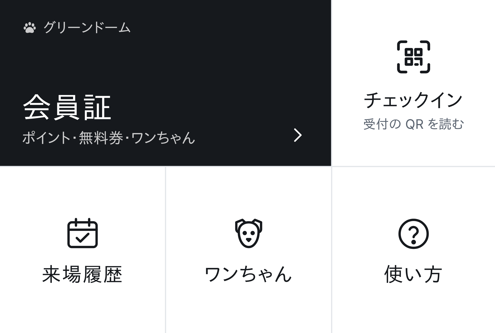

# LINE 公式アカウントのリッチメニュー

トーク画面の下に、会員証・チェックイン・来場履歴・ワンちゃん・使い方を常に出す。押すと LINE の中で会員証(LIFF)が開く。

- 画像: `docs/line/richmenu.png`(2500×1686、大きいサイズ)。作り直すときは `docs/line/richmenu.html` を直して `node docs/line/make-richmenu.mjs`。
- LIFF ID: `2012268866-TDSM6zyj`

## 押せる場所と開く URL

| 場所 | 画像の範囲(左上から) | 開く URL |
| --- | --- | --- |
| A 会員証 | 左上の大きい黒い所 | `https://liff.line.me/2012268866-TDSM6zyj/` |
| B チェックイン | 右上 | `https://liff.line.me/2012268866-TDSM6zyj/checkin` |
| C 来場履歴 | 下の左 | `https://liff.line.me/2012268866-TDSM6zyj/history` |
| D ワンちゃん | 下のまん中 | `https://liff.line.me/2012268866-TDSM6zyj/dogs` |
| E 使い方 | 下の右 | `https://liff.line.me/2012268866-TDSM6zyj/help` |

チェックイン(B)は、開くと「受付の QR を読む」ボタンが出て、押すと LINE のカメラで受付の QR コードを読める。そのために、LIFF アプリの設定の「Scan QR」をオンにしておく(下の手順 0)。

## 設定の手順(LINE Official Account Manager、15分ほど)

0. **LIFF の QR 読み取りをオンにする**: [LINE Developers](https://developers.line.biz) → チャネル → 「LIFF」タブ → LIFF アプリの「編集」→「Scan QR」をオン → 保存。
1. [LINE Official Account Manager](https://manager.line.biz) を開き、グリーンドームの公式アカウントを選ぶ。
2. 上のメニューの「ホーム」→ 左の「トークルーム管理」→「リッチメニュー」→「作成」。
3. 「タイトル」に「会員証メニュー」(お客さんには見えない)。「表示期間」は今日から先の日付(例: 10年後まで)。
4. 「メニューバーのテキスト」に「会員証・メニュー」。「メニューのデフォルト表示」は「表示する」。
5. 「コンテンツ設定」の「テンプレートを選択」で、**大きいサイズの「上に2つ(左が大きい)・下に3つ」の形**を選ぶ(左上が横長、右上が1つ、下が3つに分かれているもの)。
6. 「画像を作成」ではなく「背景画像をアップロード」で、`richmenu.png` を選ぶ。
7. A〜E のそれぞれで、「タイプ」を「リンク」にし、上の表の URL を入れる。「アクションラベル」には「会員証」「チェックイン」「来場履歴」「ワンちゃん」「使い方」(読み上げに使われる)。
8. 「保存」を押す。スマホの LINE で公式アカウントのトークを開き直すと、下にメニューが出る。

## あわせてやるとよいこと

- **あいさつメッセージ**: 「ホーム」→「あいさつメッセージ」に、友だち追加したときの文を入れる。例:「グリーンドームの公式アカウントです。下のメニューの『会員証』から、はじめての登録ができます(1分ほど)。」
- **LINE ログインのチャネルと公式アカウントをつなぐ**: [LINE Developers](https://developers.line.biz) → LINE ログインのチャネル →「チャネル基本設定」→「リンクされた LINE 公式アカウント」で、グリーンドームの公式アカウントを選ぶ。会員証を開いたときに、公式アカウントの友だち追加を出せる(LIFF の「友だち追加オプション」を「On (Normal)」にする)。
