# 操作マニュアル(管理者用)

ドッグランの受付・管理画面の使い方です。毎日の受付から、お客さんの対応、設定、分析まで、管理者が使うすべての画面を説明します。

- 受付スタッフ向けの短い説明は [manual-staff.md](manual-staff.md) にあります。
- お客さん向けの案内は [manual-customer.md](manual-customer.md) にあります。
- 写真は、ブラウザだけで動くデモ([demo.md](demo.md))の画面です。名前や数字は架空のものです。

## もくじ

1. [はじめに](#1-はじめに)
2. [毎日の受付](#2-毎日の受付)
3. [お客さんの対応](#3-お客さんの対応)
4. [設定](#4-設定)
5. [分析](#5-分析)
6. [記録](#6-記録)
7. [困ったとき](#7-困ったとき)
8. [はじめに試してみること](#8-はじめに試してみること)

## 1. はじめに

### 1.1 ログイン

1. 受付のタブレットかパソコンで、管理画面を開きます。
2. 「メールアドレス」と「パスワード」を入れます。
3. 「ログイン」を押します。
4. 「今日の来場」の画面が出たら、ログインできています。

- 一度ログインすると、30日間はそのまま使えます。
- パスワードを5回まちがえると、15分ログインできなくなります。時間をおいてから試してください。
- 終わるときは、左下の「ログアウト」を押します。受付のタブレットは、ログインしたままで構いません。

### 1.2 画面の見方

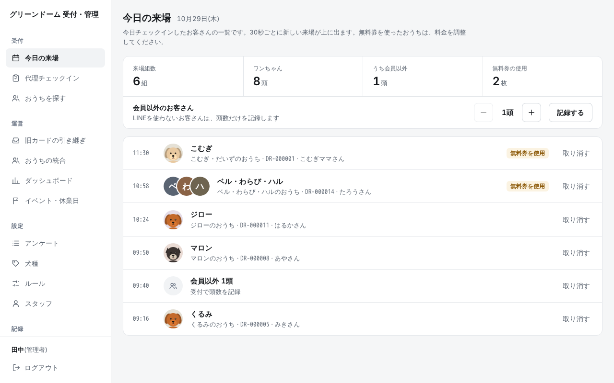

- **左のメニュー**: 使う画面を選びます。「受付」「運営」「設定」「記録」のまとまりに分かれています。
- **左下**: ログインしている人の名前と役割、「ログアウト」。
- **右の本文**: いま開いている画面です。画面の名前の下に、短い使い方が書いてあります。迷ったら、まずそこを読んでください。
- **確認待ちの数**: お客さんからの申請があると、「今日の来場」の上に「確認待ちが ○件 あります」と出ます。
- 一番下の「使い方・困ったとき」に、よくある質問と製作者への連絡先があります。

### 1.3 役割の分担

管理画面を使う人は3種類です。メニューに出る画面は、役割で変わります。

| 役割 | できること |
| --- | --- |
| 管理者 | すべての操作。ポイントの手動登録、名前や写真の変更、家族の追加と解除、おうちの統合、旧カードの移行、設定、スタッフの管理、分析 |
| 受付スタッフ | 今日の来場、取り消し、会員以外の記録、代理チェックイン、おうちを探す、ダッシュボード(集計だけ) |
| 製作者(見るだけ) | 画面を見ることだけ。何も変えられません |

製作者のアカウントでは、画面の上に「製作者のアカウントは見るだけです」と出て、変更のボタンが出ません。

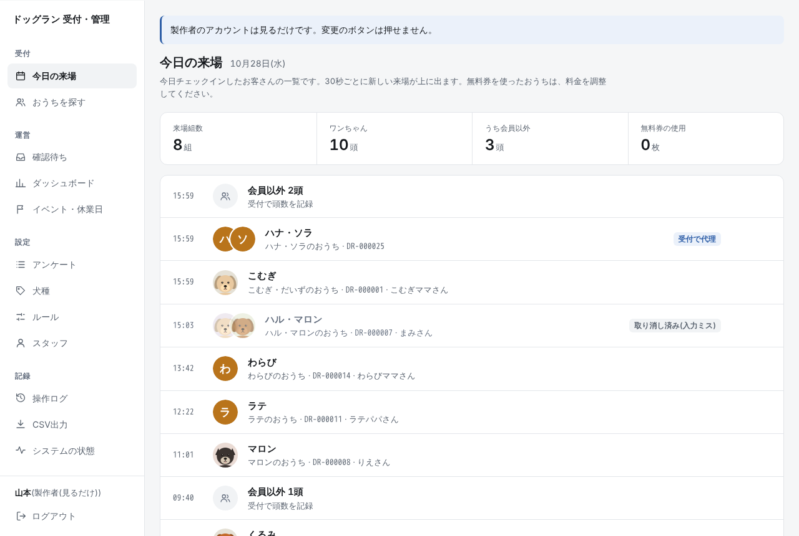

**製作者に頼むことは、例外だけです。**

- 毎日やることはありません。天気の取り込み、集計、期限切れの処理、毎日の保存(バックアップ)は自動で動きます。
- ポイントの手動登録、名前や写真の変更、家族の追加、おうちの統合、設定の変更は、すべて管理画面でできます。製作者に頼む必要はありません。
- 間違えても、ほとんどの操作は「操作ログ」から元に戻せます(6.1)。
- 製作者に連絡するのは、システムが動かないとき、元に戻せないとき、画面を変えたいときです(7.2)。

## 2. 毎日の受付

### 2.1 今日の来場を見る

1. メニューの「今日の来場」を押します(ログインすると最初にこの画面が出ます)。
2. 上の数字で、今日の来場組数・ワンちゃんの頭数・会員以外の頭数・無料券の使用枚数を確かめます。
3. 下の一覧で、チェックインしたおうちを確かめます。新しい来場が上に出ます。
4. 「無料券を使用」の印が付いたおうちは、料金を調整します。お客さんが会員証の無料券の「使用する」を押すと、その日のそのおうちに印が付きます(チェックインの前でも後でも)。

- 一覧は30秒ごとに自動で新しくなります。
- 「受付で代理」の印は、受付が代理でチェックインした来場です。
- お客さんのスマホのチェックイン完了の画面と「無料券を使用しました」の画面には、時計が動いて表示されます。止まっている画面は、写真(スクリーンショット)の可能性があります。

### 2.2 チェックインを取り消す

二重のチェックインや、入力の間違いを取り消します。付けたポイントと、その来場に結びついた無料券の使用は元に戻ります(ほかの日に使った無料券は戻りません)。

1. 「今日の来場」で、取り消す行の右の「取り消す」を押します。
2. 何が元に戻るかを読みます。
3. 「取り消す理由」を選びます(入力ミス・二重のチェックイン・お客さんの勘違い・その他)。
4. 右下の「取り消す」を押します。
5. 行に「取り消し済み(理由)」の印が付きます。

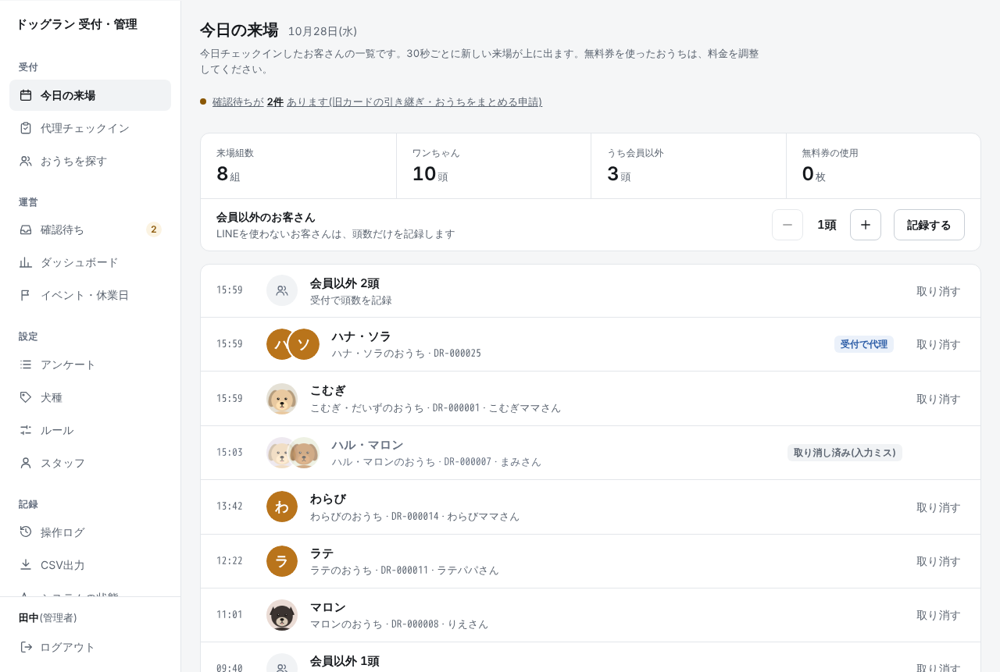

- 来場の記録は消えずに「取り消し済み」として残ります。
- 取り消した日は、お客さんがもう一度チェックインできます。
- 取り消せないと出たときは、画面の案内に従ってください(以前の記録で、そのチェックインでたまって出た無料券がもう使われているときなど)。
- 間違えて取り消したときは、「操作ログ」から元に戻せます。

### 2.3 会員以外のお客さんを記録する

LINE を使わないお客さんは、頭数だけを記録します。

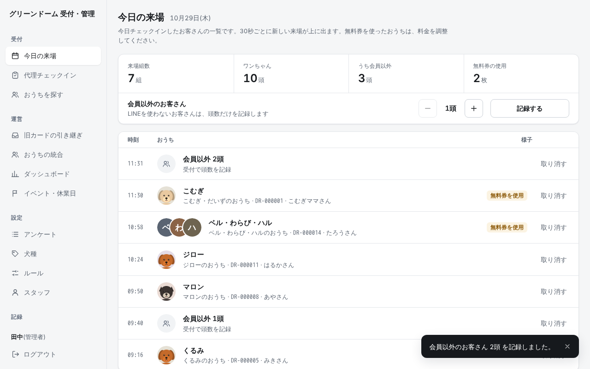

1. 「今日の来場」の「会員以外のお客さん」の行を見ます。
2. 「−」「+」で頭数を合わせます。
3. 「記録する」を押します。
4. 「会員以外のお客さん ○頭 を記録しました。」と出て、一覧に「会員以外 ○頭」の行が増えます。

間違えたときは、その行の「取り消す」で取り消します。

### 2.4 代理チェックイン

スマホを持っていないお客さんや、受付のQRコードが読めないお客さんを、受付が代わりにチェックインします。

1. メニューの「代理チェックイン」を押します。
2. 犬の名前・おうちの呼び名・会員IDのどれかを入れて探します。
3. 出てきたおうちの行を押します。上に、そのおうちのワンちゃんと家族が出ます。
4. 「来たワンちゃん」で、今日来た子にだけ印を付けます(無料券はここでは使いません。使うときは 3.1 の「使用済みにする」)。
5. 「代理でチェックインする」を押します。
6. 「チェックインしました。」と出たら完了です。「今日の来場」に「受付で代理」の印付きで出ます。

- 紙に書いておいた日の分は、「来場日」でその日を選んでから入力します。
- その日にすでにチェックインしているおうちには、「この日は、すでにチェックイン済みです」と出ます(ポイントは1日1回)。

### 2.5 おうちを探す

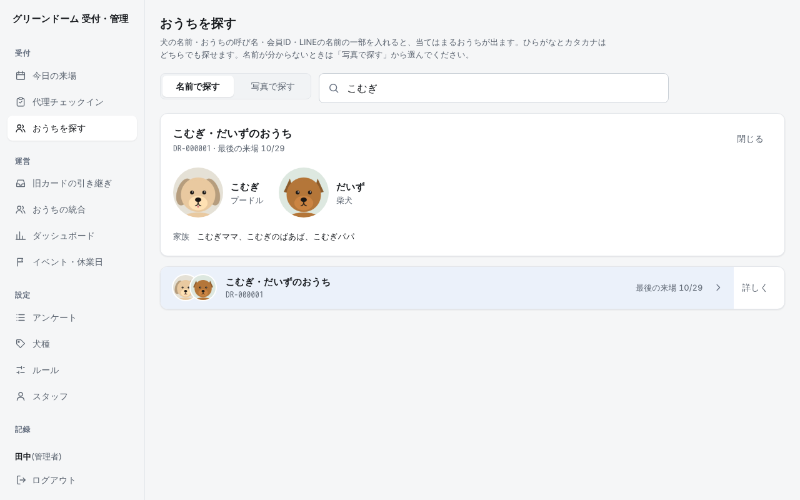

1. メニューの「おうちを探す」を押します。
2. 「名前で探す」のまま、犬の名前・おうちの呼び名・会員ID・LINE の名前の一部を入れます。
3. 出てきた行を押すと、上にワンちゃんの写真と家族が出ます。顔を見て、そのおうちかを確かめます。
4. くわしく見るときは、行の右の「詳しく」を押します(3.1 のおうちの詳細が開きます)。

- ひらがなとカタカナは、どちらで入れても探せます。
- まとめたあとの古い会員IDで探すと、「統合済み → まとめた先の会員ID」と出ます。

**名前が分からないとき**は「写真で探す」を押します。最近来たワンちゃんの写真が並ぶので、顔で選びます。

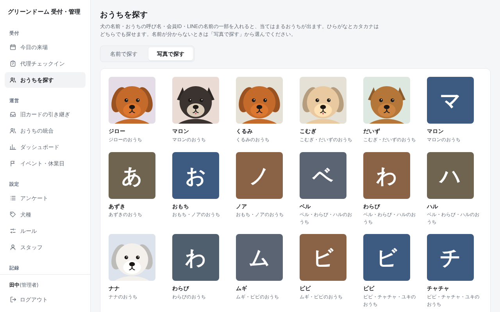

## 3. お客さんの対応

### 3.1 おうちの詳細

おうちの家族・ワンちゃん・来場・ポイントをまとめて見る画面です。

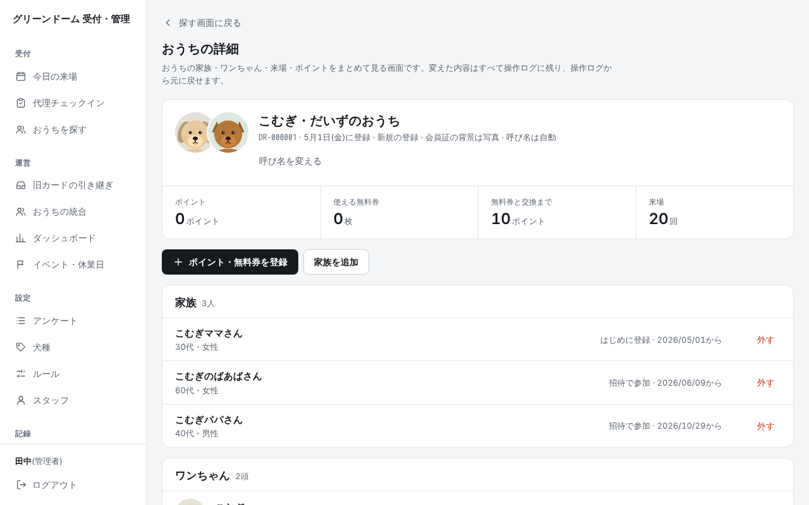

1. 「おうちを探す」でおうちを探し、「詳しく」を押します。
2. 上の欄で、呼び名・会員ID・ポイント・使える無料券・無料券と交換まで・来場回数を確かめます。
3. 下へ進むと「家族」「ワンちゃん」「来場履歴」「ポイントの記録」「無料券」「アンケート」が並んでいます。
4. 呼び名を変えるときは「呼び名を変える」を押し、新しい呼び名を入れて「呼び名を保存」を押します。
5. スマホを持っていないお客さんが無料券を使うときは、「無料券」の未使用の行の「使用済みにする」を押し、確認の画面でもう一度「使用済みにする」を押します。その日のチェックインがあれば、その来場に結びつきます。間違えたときは、操作ログから未使用に戻せます。

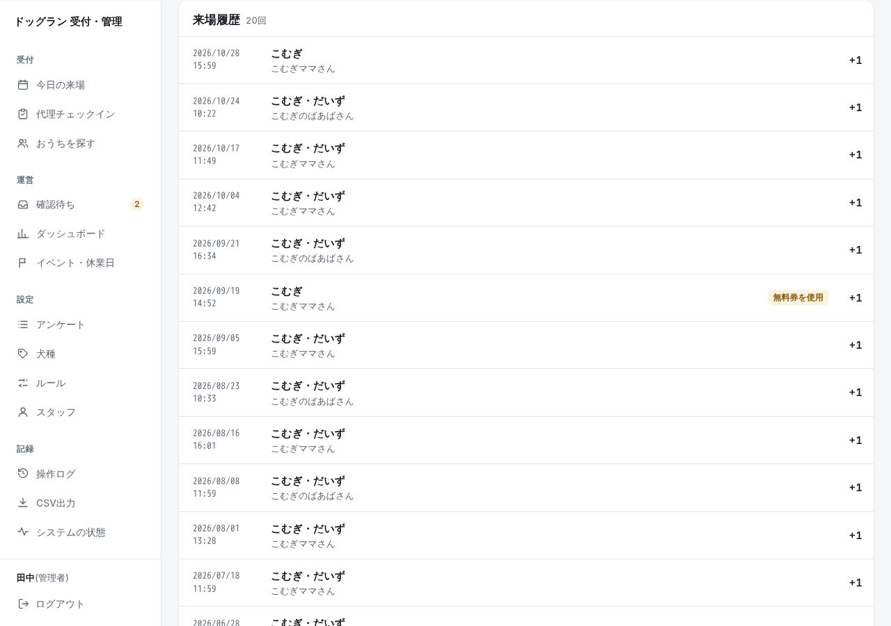

- 呼び名を空にして保存すると、ワンちゃんの名前から自動で作ります(例: アル・ニコのおうち)。
- 変えた内容はすべて操作ログに残り、そこから元に戻せます。

### 3.2 ポイント・無料券の手動登録

付け忘れたポイントや、イベントの特典などを、手で増やす・減らす操作です。登録の前に、結果を確かめる画面が出ます。

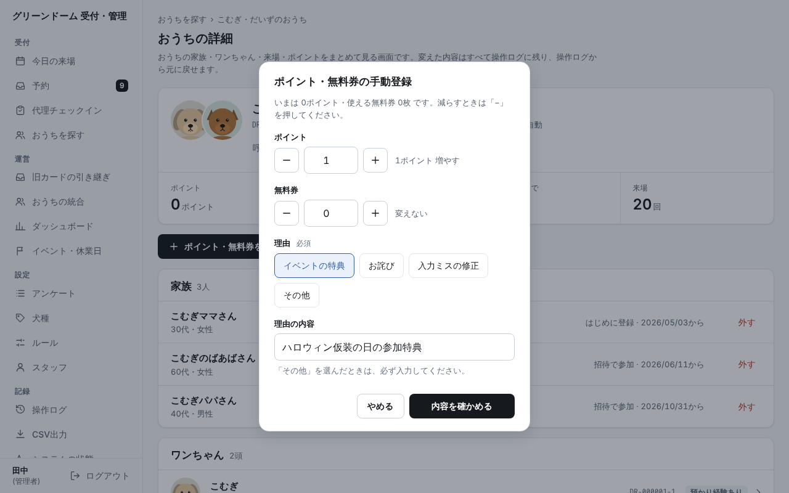

1. おうちの詳細で「ポイント・無料券を登録」を押します。
2. 「ポイント」「無料券」の「+」「−」で、増やす・減らす数を合わせます。
3. 「理由」を選びます(イベントの特典・お詫び・入力ミスの修正・その他)。必要なら「理由の内容」に書きます(「その他」のときは必ず書きます)。
4. 「内容を確かめる」を押します。
5. 「この内容で登録しますか」で、登録の前と後のポイント・無料券を確かめ、「登録する」を押します。

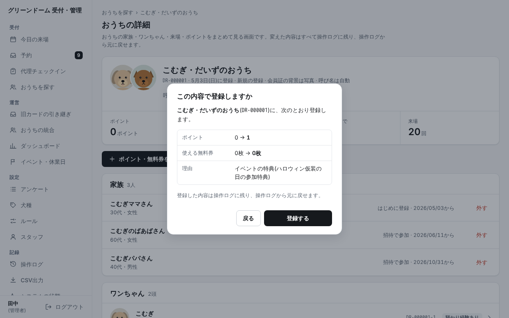

- ポイントが10以上になっても、無料券には自動で替えません(交換はお客さんが会員証で押します)。無料券を足すときは「無料券」の「+」で増やします。
- 間違えたときは、「操作ログ」の「元に戻す」で戻せます(6.1)。

### 3.3 ワンちゃんの名前と写真を変える

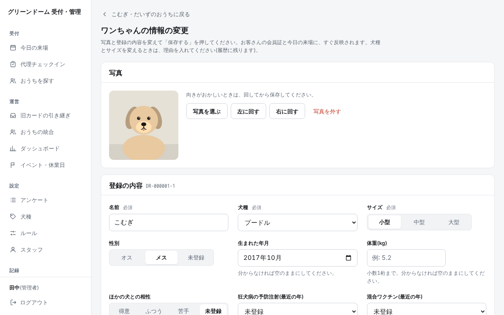

1. おうちの詳細の「ワンちゃん」で、変える子の行を押します。
2. 写真を変えるときは「写真を選ぶ」を押して写真を選びます。向きがおかしいときは「左に回す」「右に回す」で直します。
3. 名前・犬種・サイズ・性別・生まれた年月を直します。
4. 犬種かサイズを変えたときは、「犬種・サイズを変える理由」を入れます。
5. 「保存する」を押します。

- 保存すると、お客さんの会員証と「今日の来場」に、すぐ反映されます。
- 写真をやめるときは「写真を外す」を押して保存します(犬種の色と名前の頭文字の絵になります)。
- 選んだ写真をやめるときは「写真の変更をやめる」を押します。
- 犬種とサイズは、お客さんには変えられません。間違いを頼まれたら、この画面で直します。変えた記録は下の「変更の履歴」に残ります。
- 亡くなった子や来なくなった子は「登録を解除する」を押します。来場の記録は残り、チェックインで選べなくなります。

### 3.4 家族を追加する

受付で、おうちに家族を加えます。家族のスマホで QR コードを読み取ってもらいます。

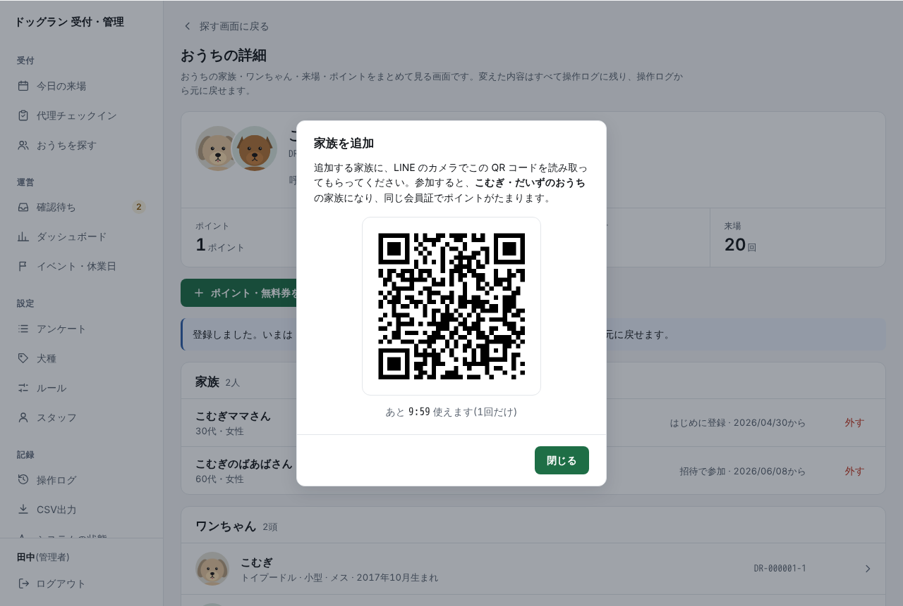

1. おうちの詳細で「家族を追加」を押します。
2. 画面に QR コードが出ます。
3. 加わる家族に、LINE のカメラでこの QR コードを読み取ってもらいます。
4. 家族のスマホで「参加する」を押してもらいます。
5. 「閉じる」を押します。「家族」の一覧に、新しい家族が出ます。

- QR コードは10分間、1回だけ使えます。期限が切れたら「新しいQRコードを出す」を押します。
- お客さん同士で、会員証の「家族を招待」から招待することもできます(お客さん向けの案内を参照)。

### 3.5 家族を外す

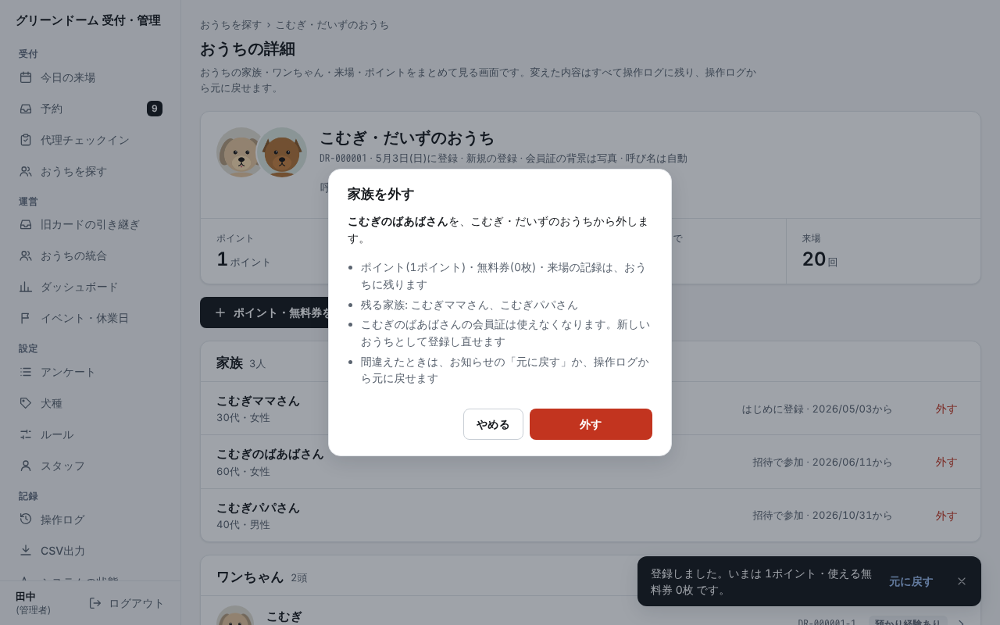

1. おうちの詳細の「家族」で、外す人の右の「外す」を押します。
2. 外したあとの内容(ポイントはおうちに残ること、残る家族)を確かめます。
3. 「外す」を押します。

- ポイント・無料券・来場の記録は、おうちに残ります。
- 外した人の会員証は使えなくなります。その人は、新しいおうちとして登録し直せます。
- おうちに残る最後の1人は外せません。
- 間違えたときは、操作ログから元に戻せます。

### 3.6 おうちをまとめる(統合)

家族が別々に登録して、ポイントが2つのおうちに分かれたときに、1つにまとめます。

お客さん同士なら、管理者の操作は要りません。片方が会員証の「家族を招待」で招待を送り、もう片方が開いて「まとめる」を押すと、その場で1つになります(ワンちゃんの同じ子も、お客さんが選びます)。お客さんがまとめたときは、「操作ログ」に「おうちをまとめる」として、まとめたお客さんの名前(「○○さん(お客さん)」)で残ります。受付で「家族を追加」の QR コード(3.4)を読み取ってもらっても、同じようにまとめられます。

お客さんが操作できないときや、受付で写真を見ながらまとめたいときは、この画面でまとめます。

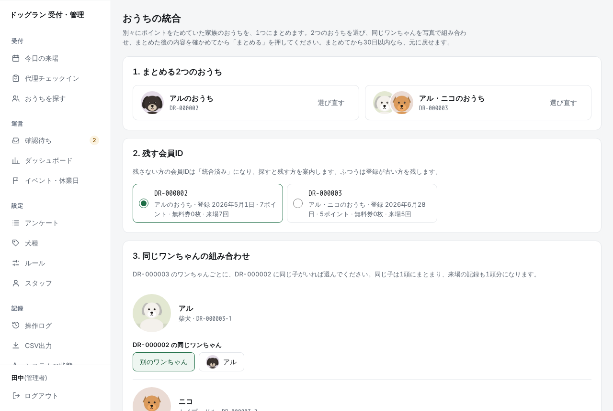

1. 「確認待ち」の右上の「おうちの統合を開く」を押し、まとめる2つのおうちを探して選びます。
2. 「2. 残す会員ID」を選びます。ふつうは登録が古い方を残します。
3. 「3. 同じワンちゃんの組み合わせ」で、写真を見て、同じ子どうしを選びます。違う子は「別のワンちゃん」のままにします。同じ子にしたときは、残す写真・名前・犬種を選びます。
4. 「4. まとめた後」で、ポイント・無料券・来場回数・家族・ワンちゃんを確かめます。
5. 「まとめる」を押し、確認の画面でもう一度「まとめる」を押します。

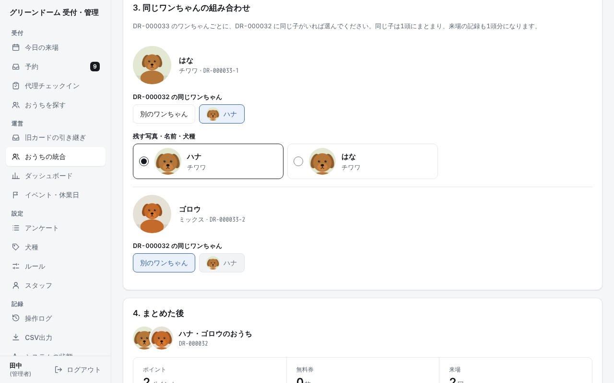

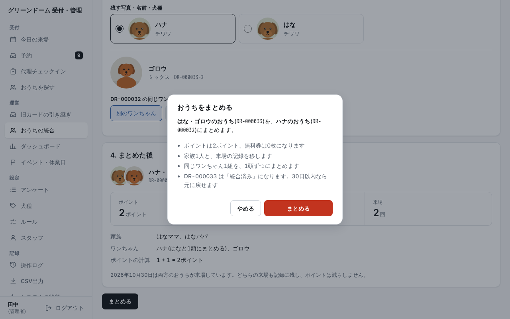

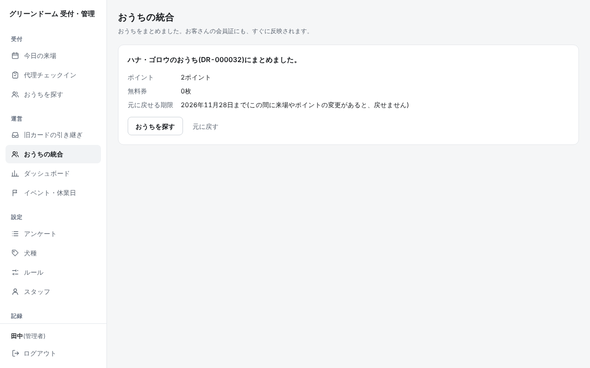

- ポイントは合計されます。10ポイントをこえても、無料券には自動で替えません(例: 7ポイントと5ポイント → 12ポイント。交換はお客さんが会員証で押します)。
- 残さない方の会員IDは「統合済み」になり、探すと残した方を案内します。
- まとめてから30日以内なら、元に戻せます。まとめた直後の画面の「元に戻す」か、「操作ログ」の「元に戻す」を使います。その間に来場やポイントの変更があると、戻せません。お客さんが招待からまとめたものも、同じように「操作ログ」から元に戻せます。

### 3.7 確認待ち(お客さんからの申請)

以前にお客さんから届いた「旧カードの引き継ぎ」の申請が並びます(いまは、お客さんからの申請は受け付けていません。おうちをまとめるのも、お客さんが招待から自分でできるので、ここには出ません)。

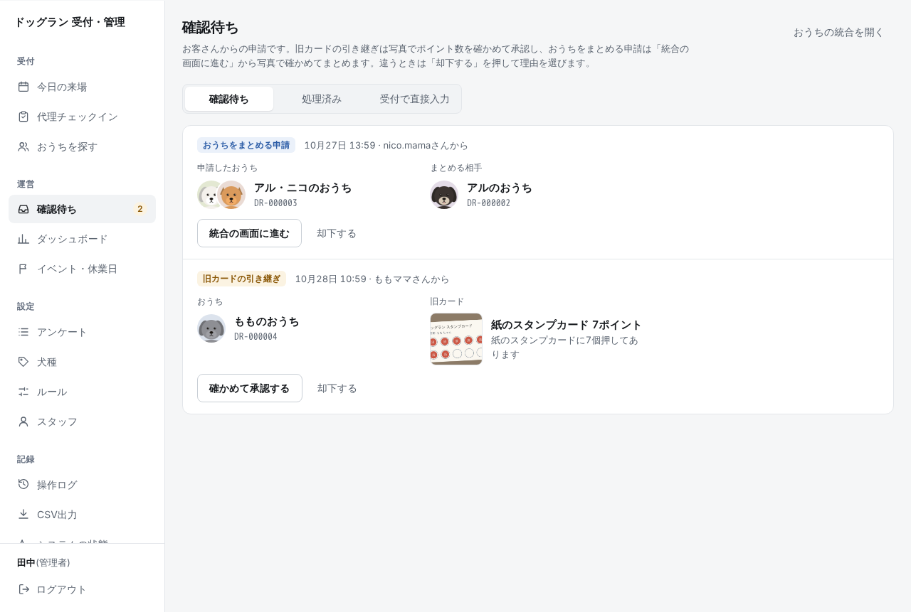

1. 「今日の来場」の上の「確認待ちが ○件 あります」を押します。
2. 以前に届いた「旧カードの引き継ぎ」の申請は、承認できません。「却下する」を押し、理由を選んで「却下する」を押します。お客さんには、受付で旧カードを見せてもらい、「旧カードの引き継ぎ」で入力します(3.8)。ポイントやおうちは変わりません。

- 承認・却下した申請は、「処理済み」で見られます。

### 3.8 旧カードの移行

LINE のショップカードと紙のスタンプカードのポイントを、新しい会員証に引き継ぎます。引き継ぎは、お客さんが受付で旧カードを見せてくれたときだけ行います(お客さんが LINE から申請する方法はありません)。

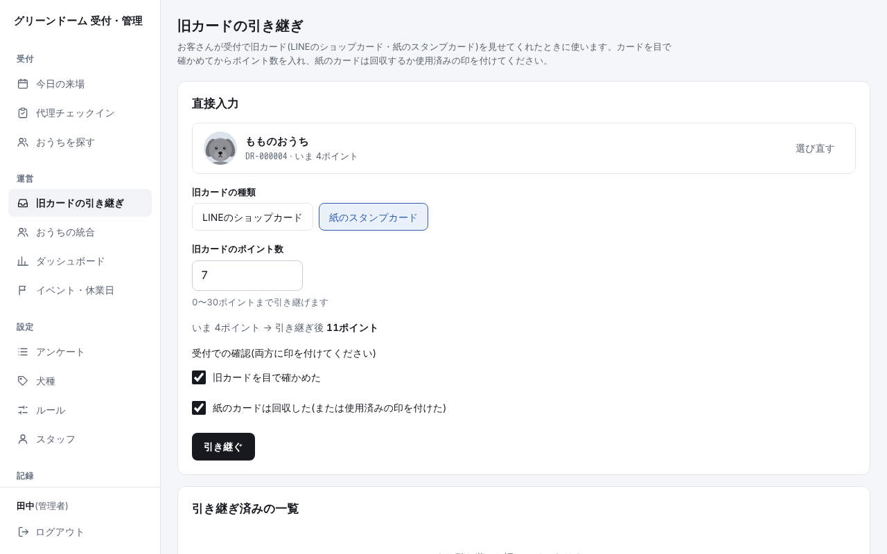

1. メニューの「旧カードの引き継ぎ」を押します。
2. 「直接入力」の「引き継ぐおうちを探す」で、おうちを探して選びます。
3. 「旧カードの種類」を選び、カードを数えて「旧カードのポイント数」を入れます。
4. 「旧カードを目で確かめた」と「紙のカードは回収した(または使用済みの印を付けた)」の両方に印を付けます。印がないと「引き継ぐ」は押せません。
5. 「引き継ぐ」を押し、確認の画面でもう一度「引き継ぐ」を押します。
6. 紙のカードは回収するか、使用済みの印を押してお返しします。

- 一度に引き継げるポイントには上限があります(初期は30ポイント。「ルール」の「移行期間」で変えられます)。超えると「引き継げるポイントは最大30ポイントです。」と出ます。
- 同じ種類のカードは、1つのおうちで1回だけ引き継げます。
- 引き継げるのは「ルール」で決めた移行期間の間だけです。期間の外のときは、画面に案内が出ます。
- 引き継いだポイントで10ポイントをこえても、無料券には自動で替えません。
- 下の「引き継ぎ済みの一覧」で、いつ・誰が・どのおうちに・何ポイント引き継いだかが見られます。間違えたときは、その行の「元に戻す」で戻せます(操作ログからも戻せます)。

## 4. 設定

設定の画面は、管理者だけが使えます。変えた内容は操作ログに残り、そこから元に戻せます。

### 4.1 ルール

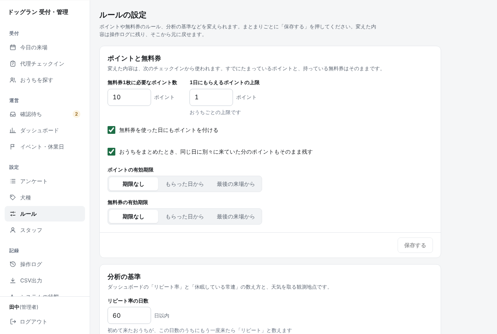

1. メニューの「ルール」を押します。
2. 変えたいまとまりを探します(ポイントと無料券・分析の基準・招待・受付のQRコード・移行期間・利用規約とプライバシーポリシー・製作者の連絡先)。
3. 数や選択を変えます。
4. そのまとまりの「保存する」を押します。

- **ポイントと無料券**: 無料券1枚と交換するのに必要なポイント数、1日にもらえるポイントの上限、無料券を使った日にもポイントを付けるか、有効期限。変えた内容は次のチェックインから使われます。いまのポイントと無料券はそのままです。
- **分析の基準**: リピート率の日数、常連とみなす来場回数、休眠とみなす日数、天気の観測地点。
- **招待**: お客さん同士の招待と、受付で出す招待QRコードの有効時間。
- **受付のQRコード**: 「画像を保存する」で保存して印刷し、受付に置きます。「合言葉を作り直す」を押すと、前に印刷したQRコードは使えなくなります。新しいものを印刷して取り替えてください。
- **移行期間**: 旧カードを引き継げる期間と、一度に引き継げるポイントの上限(1〜200。初期は30)。期間が終わると、以前に届いた申請の写真は自動で消えます。

### 4.2 犬種

お客さんがワンちゃんを登録するときに選ぶ犬種です。

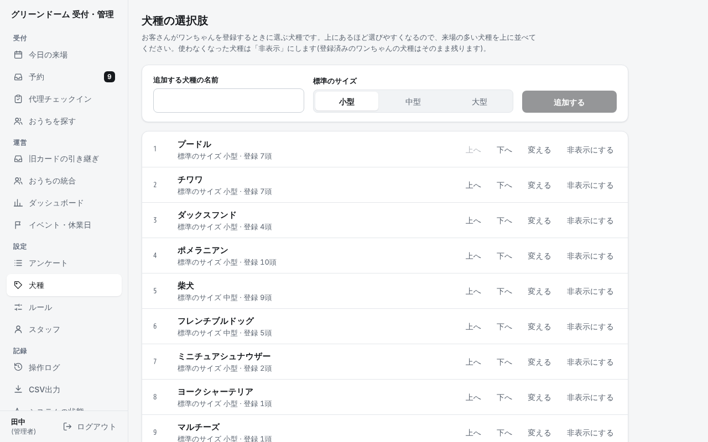

1. メニューの「犬種」を押します。
2. 追加するときは、「追加する犬種の名前」を入れ、「標準のサイズ」を選んで「追加する」を押します。
3. 並べ替えるときは「上へ」「下へ」を押します。来場の多い犬種を上にすると、選びやすくなります。
4. 名前や標準のサイズを直すときは「変える」、使わない犬種は「非表示にする」を押します。

- 非表示にしても、登録済みのワンちゃんの犬種はそのまま残ります。
- 「その他」は、一覧にない犬種を書いてもらうためのもので、いつも最後に出ます。

### 4.3 アンケート

お客さんに聞く質問です。

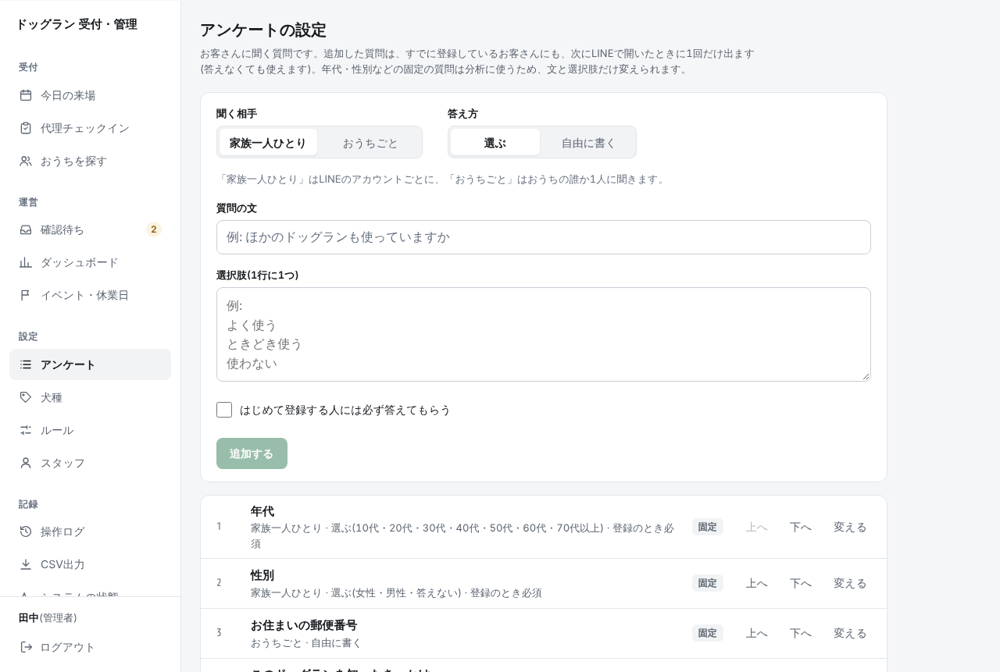

1. メニューの「アンケート」を押します。
2. 「聞く相手」(家族一人ひとり・おうちごと)と「答え方」(選ぶ・自由に書く)を選びます。
3. 「質問の文」を入れます。「選ぶ」のときは「選択肢」を1行に1つずつ入れます。
4. 「追加する」を押します。

- 追加した質問は、登録済みのお客さんにも、次に LINE で開いたときに1回だけ出ます(答えなくても使えます)。
- 「固定」の印がある質問(年代・性別など)は分析に使うため、文と選択肢だけ変えられます。
- 使わなくなった質問は「非表示にする」にします。「集計」で、選択肢ごとの回答の数が見られます。

### 4.4 スタッフ

管理画面を使う人のアカウントです。

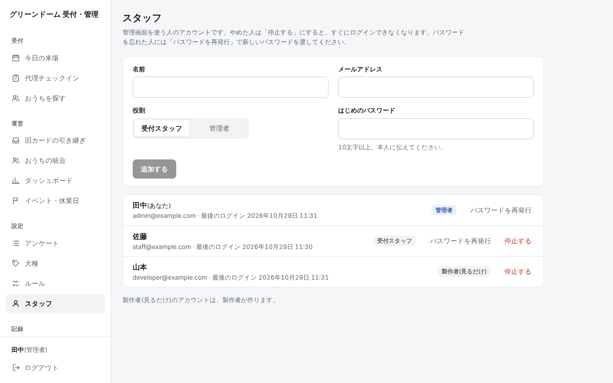

1. メニューの「スタッフ」を押します。
2. 「名前」「メールアドレス」を入れ、「役割」(受付スタッフ・管理者)を選びます。
3. 「はじめのパスワード」を10文字以上で入れます。
4. 「追加する」を押し、メールアドレスとパスワードを本人に伝えます。

- やめた人は「停止する」を押します。すぐにログインできなくなります。「再開する」で戻せます。
- パスワードを忘れた人や、5回まちがえてしばらく入れなくなった人(「しばらく入れない状態」と出ます)は「パスワードを再発行」を押し、出てきた新しいパスワードを本人に伝えます。この画面を閉じると、もう表示できません。
- 管理者自身がパスワードを忘れたときは、製作者に頼みます。

### 4.5 イベント・休業日

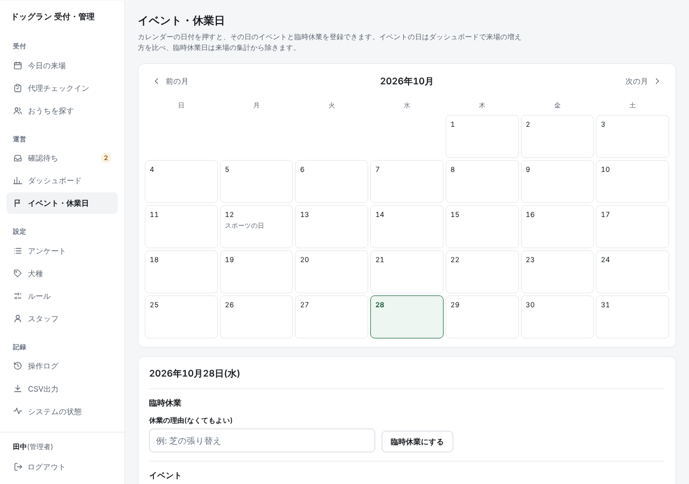

1. メニューの「イベント・休業日」を押します。
2. カレンダーで日付を押します(別の月は「前の月」「次の月」)。
3. 臨時休業にするときは、「休業の理由」を入れて(なくてもよい)「臨時休業にする」を押します。
4. イベントを登録するときは、下の「イベント」で名前・種類・メモを入れて「イベントを追加」を押します。

- 臨時休業日は、来場の集計から除かれます。
- イベントの日は、ダッシュボードの「イベントの効果」で、ふだんの日と比べられます。

## 5. 分析

### 5.1 ダッシュボードの見方

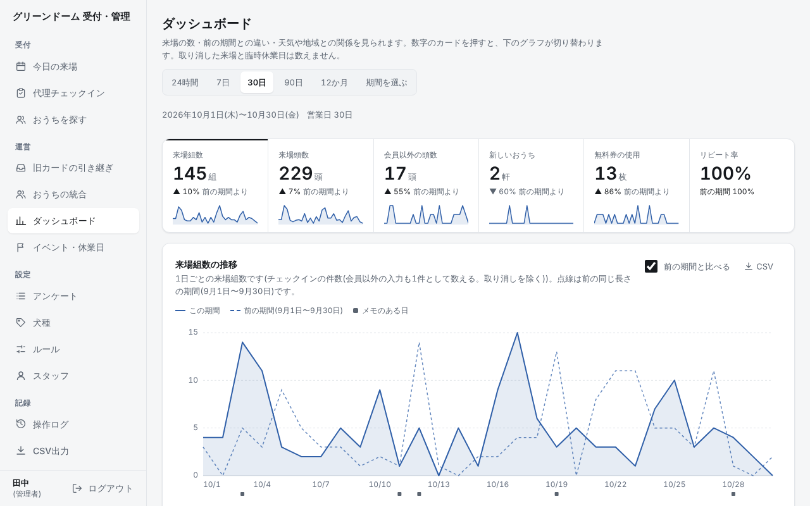

1. メニューの「ダッシュボード」を押します。
2. 上で期間を選びます(今月・先月・過去3か月・過去12か月・期間を選ぶ)。
3. 上の数字で、期間全体の様子を見ます。
4. 下へ進んで、グラフを見ます。グラフの点や棒に指を置くと、くわしい数が出ます。

| 数字 | 意味 |
| --- | --- |
| 来場頭数 | 来たワンちゃんの数(会員以外を含む) |
| 来場組数 | チェックインの件数(会員以外を含む) |
| 1日あたりの頭数 | 営業日1日あたりの平均 |
| 新しいおうち | 期間中に登録したおうちの数 |
| リピート率 | 初めて来たおうちが、決めた日数(初めは60日)のうちにもう一度来た割合 |
| 無料券の利用 | 発行した無料券のうち、使われた割合 |

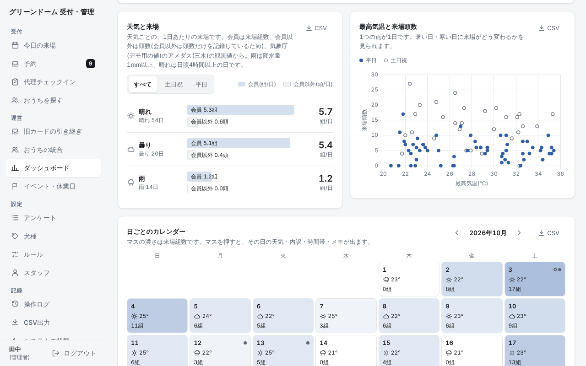

- **来場の推移**: 日ごと・月ごとの頭数と組数。
- **天気ごと・曜日ごとの1日あたりの頭数**: 晴れと雨、平日と土日の違いが分かります。
- **犬種・サイズ・年齢・飼い主の年代・性別・地域・知ったきっかけ**: どんなお客さんが来ているか。
- **最高気温と来場頭数**: 暑い日・寒い日の来場の変わり方。

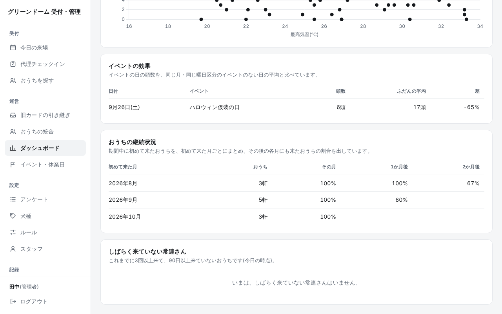

- **イベントの効果**: イベントの日の頭数を、ふだんの同じ曜日の平均と比べます。
- **おうちの継続状況**: 初めて来たおうちが、その後の月にも来ているか。
- **しばらく来ていない常連さん**: 何回も来ていたのに、しばらく来ていないおうち。声かけの参考にします。

取り消した来場と、臨時休業日は数えません。受付スタッフは、全体の数字とグラフだけを見られます(おうちの継続状況・しばらく来ていない常連さん・家族での利用・追加したアンケートの回答は出ません)。

## 6. 記録

### 6.1 操作ログと元に戻す

誰が・いつ・何を変えたかの一覧です。間違えた操作を、ここから元に戻せます。

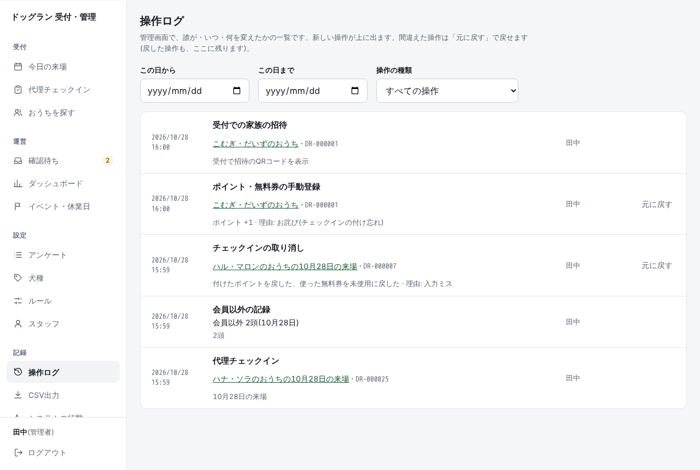

1. メニューの「操作ログ」を押します。
2. 必要なら「この日から」「この日まで」「操作の種類」で絞り込みます。
3. 戻したい操作の右の「元に戻す」を押します。
4. 戻す内容を確かめて、「元に戻す」を押します。

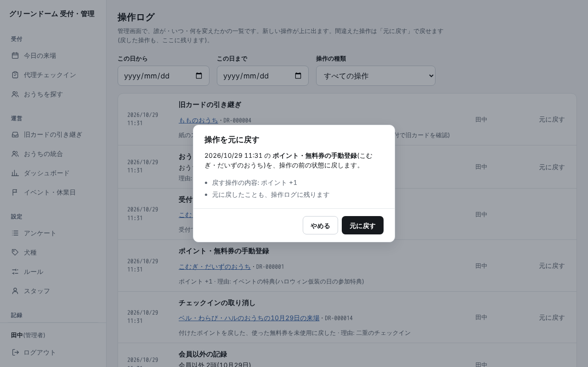

- 元に戻せるのは、ポイントの手動登録、取り消し、無料券の交換・使用・使用済みにする、名前・写真・犬種の変更、呼び名の変更、家族を外す、おうちの統合(30日以内。お客さんが招待からまとめたものも含む)、旧カードの引き継ぎ、申請の却下、設定・犬種・アンケート・スタッフ・イベントの変更などです。
- 元に戻したことも、操作ログに残ります(「元に戻し済み」の印が付きます)。
- そのあとに同じものが変えられているときは、戻せません。その画面で直接直してください。

### 6.2 CSV出力

おうち・家族・ワンちゃん・来場・ポイント台帳・アンケートの回答を、Excel で開けるファイルにして保存します。

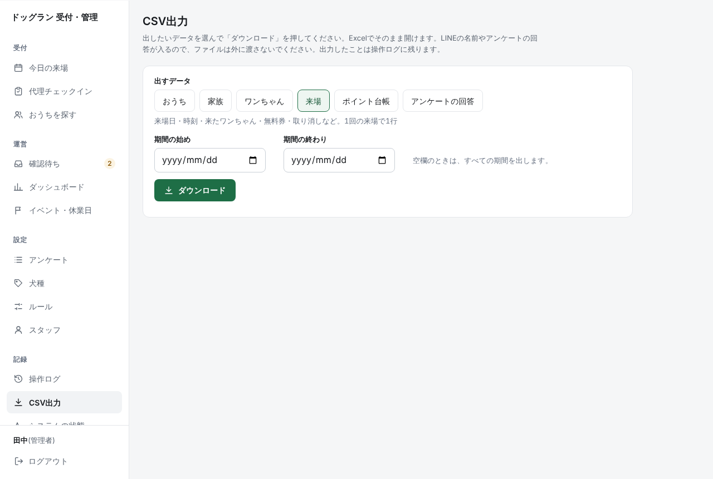

1. メニューの「CSV出力」を押します。
2. 「出す内容」を選びます。
3. 来場とポイント台帳は、「期間の始め」「期間の終わり」を選べます(空欄なら全部)。
4. 「ダウンロード」を押します。

- LINE の名前やアンケートの回答が入るので、ファイルは外に渡さないでください。
- 出力したことは、操作ログに残ります。

### 6.3 システムの状態

自動で動く処理(天気の取得、祝日の取り込み、集計、毎日の保存など)が、うまく動いているかを色で表示します。

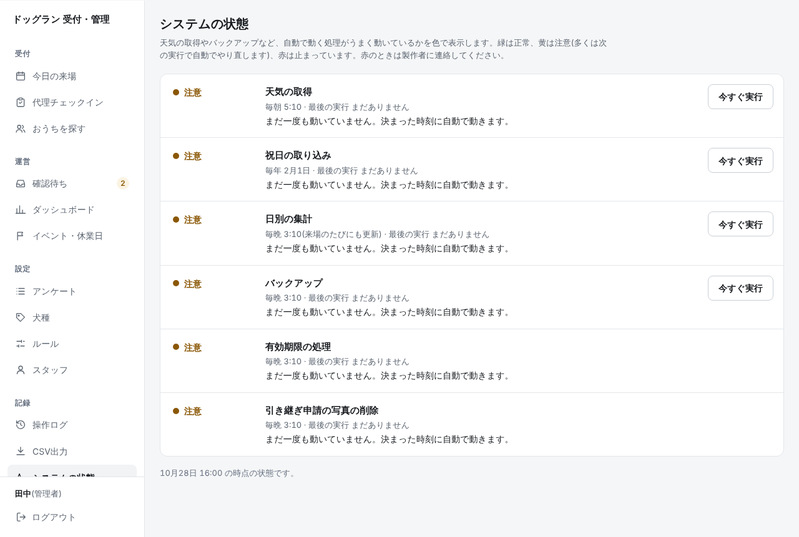

1. メニューの「システムの状態」を押します。
2. 各行の色を見ます。緑は正常、黄は注意、赤は止まっています。
3. 黄のときは、多くは次の実行で自動でやり直します。すぐに動かしたいときは「今すぐ実行」を押します。
4. 赤のときは、製作者に連絡します(7.2)。

写真はデモの画面なので、まだ一度も動いていない「注意」になっています。本番では、毎日動いて緑になります。

## 7. 困ったとき

### 7.1 よくある質問

管理画面の「使い方・困ったとき」に、よくある質問と、画面ごとの使い方がまとまっています。質問を押すと答えが開きます。

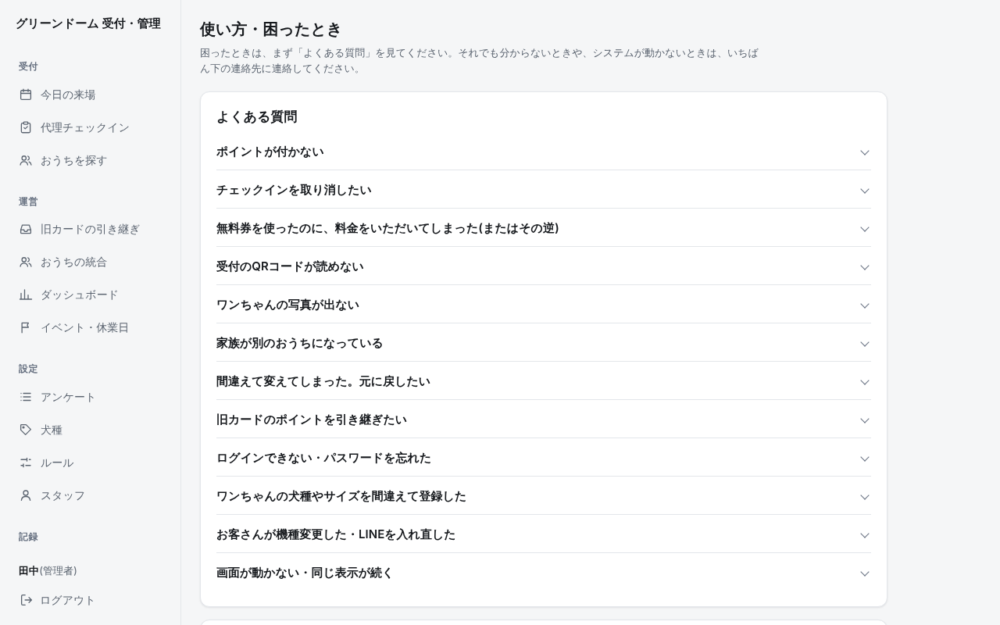

**ポイントが付かないと言われた**
ポイントはおうちごとに1日1ポイントです。同じ日に家族の誰かがチェックインしていると、2回目はポイントが付きません。「今日の来場」でそのおうちを確かめてください。付け忘れたときは、3.2 の手動登録で足します。

**家族が別のおうちになっている**
片方の方に会員証の「家族を招待」で招待を送ってもらい、もう片方の方が開いて「まとめる」を押すと、その場で1つになります。受付でまとめるときは、3.6 の「おうちをまとめる」で1つにします。どちらもポイントは合計されます。これから家族を増やすときは、会員証の「家族を招待」か、3.4 の「家族を追加」を使ってもらうと、はじめから同じおうちになります。

**無料券を使い忘れた・使うつもりがないのに使った**
使い忘れたときは、お客さんに会員証の無料券の「使用する」を押してもらうか、3.1 の「使用済みにする」を押します。使うつもりがないのに使ったときは、「操作ログ」でその操作(「無料券の使用」)を「元に戻す」と、無料券は未使用に戻ります。

**受付の QR コードが読めない**
LINE のアプリの中のカメラで読み取ってもらいます。読めないお客さんは、2.4 の代理チェックインでチェックインできます。合言葉を作り直したあとは、新しく印刷した QR コードを使います。

**お客さんが機種変更した**
同じ LINE のアカウントなら、何もしなくてそのまま使えます。新しい LINE のアカウントを作ったときは、新しいおうちになるので、3.6 でまとめます。

**間違えて変えてしまった**
6.1 の操作ログから元に戻します。おうちの統合は30日以内なら戻せます。

**スタッフがパスワードを忘れた**
4.4 の「パスワードを再発行」を使います。

**画面が動かない**
まず画面を読み込み直し、インターネットにつながっているかを確かめます。システムが止まっているときは、受付で紙に記録しておき、あとで代理チェックインの「来場日」を選んで入力できます。

### 7.2 製作者への連絡

「使い方・困ったとき」の一番下に、製作者への連絡先が出ています(連絡先は「ルール」の「製作者の連絡先」で変えられます)。次のときに連絡してください。

- 「システムの状態」が赤になっている。
- 画面が動かない・同じ表示が続く。
- 操作ログから元に戻せない変更を、元に戻したい。
- 管理者自身のパスワードを忘れた。
- 画面やルールを、設定にない形に変えたい。

連絡するときは、「いつ」「どの画面で」「何をしたら」「何と出たか」を伝えると、早く直せます。画面の写真があると助かります。

## 8. はじめに試してみること

使い始める前に、次の5つを、このマニュアルを見ないで試してください(要件定義書 19.2 の「管理者による使いやすさの確認」)。

1. 犬の名前で、あるおうちを探して開く。
2. そのおうちにポイントを1つ手動で足し、元に戻す。
3. 犬の写真を差し替える。
4. 写真を見て、2つのおうちを1つにまとめる。
5. 今日のチェックインを1件取り消す。

5つすべてを、製作者の説明なしで、それぞれ2分以内にできることを合格の目安にします。分からなかったときは、該当する章(1は 2.5 と 3.1、2は 3.2 と 6.1、3は 3.3、4は 3.6、5は 2.2)を読んでください。
