# グリーンドーム 会員証のご案内(お客さま向け)

LINE の中で使える、グリーンドーム(ドッグラン)の会員証(ポイントカード)のご案内です。店頭の案内や、LINE のメニューの説明にお使いください。写真は見本の画面で、名前や数字は架空のものです。

- 受付の QR コードを読み取るだけで、チェックインできます。
- 1日1ポイント。10ポイントたまると、会員証で無料券1枚(来場1回分)と交換できます。
- ご家族の LINE と、ポイントをいっしょにためられます。

## 1. 登録する(はじめての方)

1. ドッグランの LINE 公式アカウントを友だちに追加します。
2. 受付の QR コードを、LINE のカメラで読み取ります。「はじめての方へ」の画面が開きます。
3. 利用規約とプライバシーポリシーを読み、「同意します」に印を付けて「同意して次へ」を押します。
4. ワンちゃんの写真・名前・犬種・サイズを入れて「次へ」を押します。2頭以上いるときは、続けて追加できます。体重・ほかの犬との相性・予防注射の年は、「体重・相性・予防注射」を開いて入れられます(あとでもよい)。
5. かんたんなアンケートに答えて「登録する」を押します。必ず答えるのは、年代・性別・知ったきっかけだけです。「よければ教えてください」(来たい時間帯など)は、選ぶだけで、答えなくても登録できます。
6. 「登録が完了しました」と会員ID(DR-000123 のような番号)が出たら完了です。

| 同意 | ワンちゃんの登録 | アンケート | 登録の完了 |
| --- | --- | --- | --- |
| 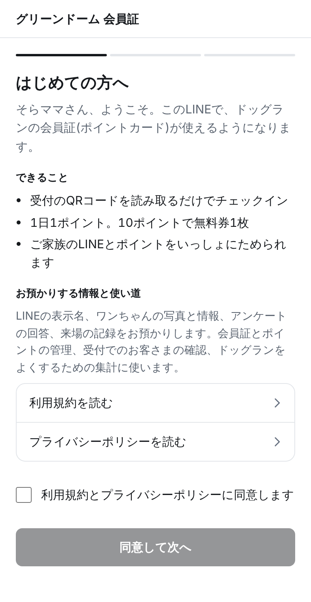 | 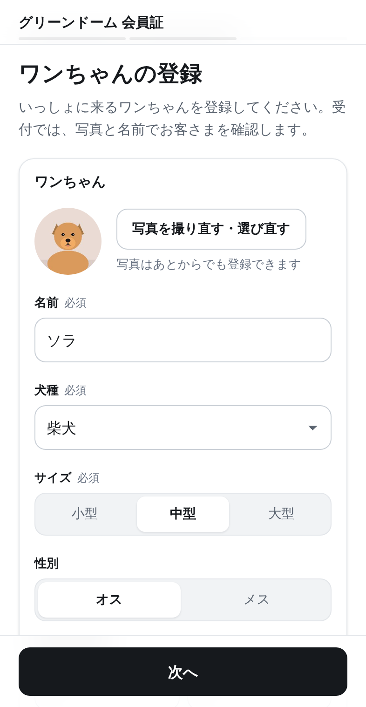 | 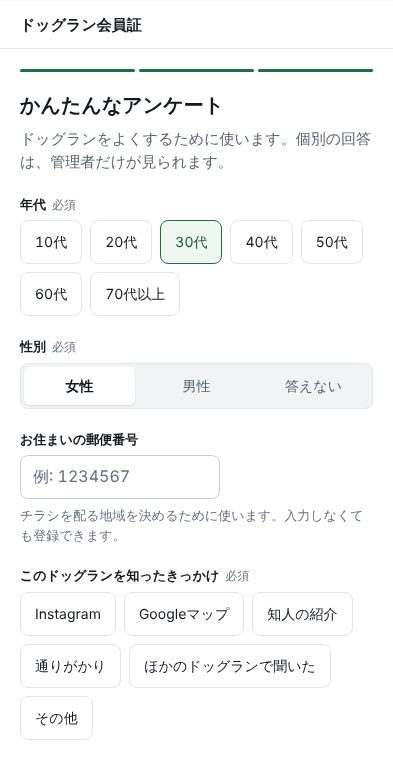 | 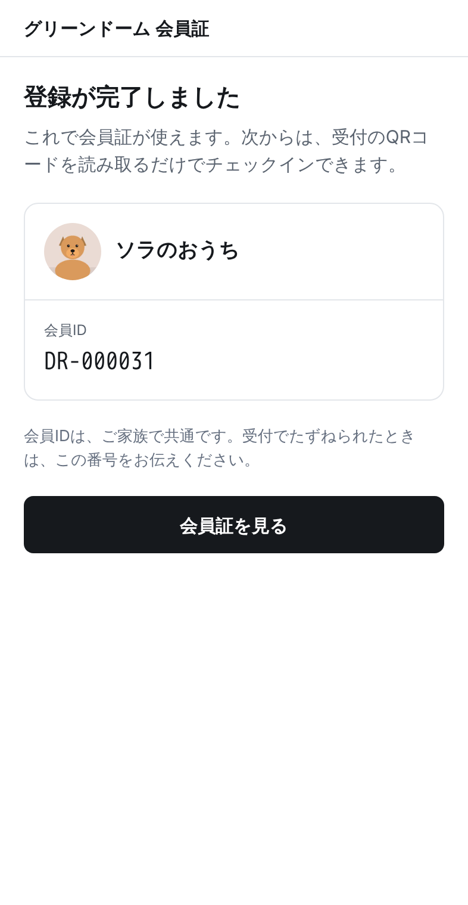 |

- 写真は、受付でお客さまを確認するのに使います。あとからでも登録できます。
- 会員IDは、ご家族で共通です。受付でたずねられたときは、この番号をお伝えください。

## 2. チェックインする

1. 受付の QR コードを、LINE のカメラで読み取ります(会員証の「チェックイン(受付のQRを読む)」からも読み取れます)。
2. 今日来たワンちゃんに印を付けます。
3. 「チェックインする」を押します。
4. 「チェックイン完了」の画面を、受付で見せてください。

| ワンちゃんを選ぶ | チェックイン完了 |
| --- | --- |
| 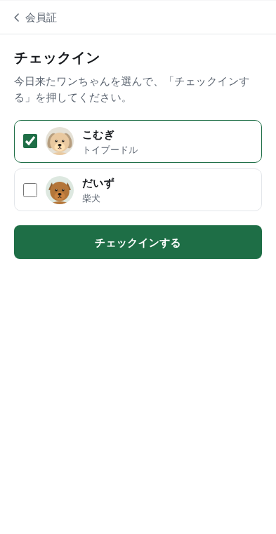 | 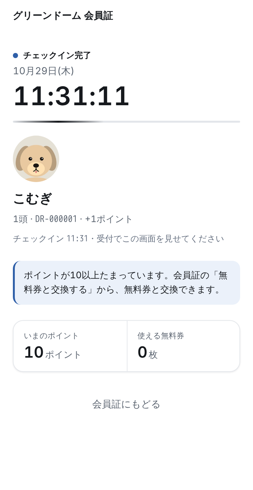 |

- ポイントは、おうちごとに1日1ポイントです。ワンちゃんが何頭いても、ご家族の誰がチェックインしても、1日1ポイントです。
- ご家族がその日にもうチェックインしているときは、一緒に来たワンちゃんを追加するだけになります(ポイントは増えません)。
- 無料券は、チェックインの画面では使いません。会員証の無料券を右へスライドして使います(3.)。無料券を使った日も、1ポイントたまります。
- スマホを忘れた日も、受付でチェックインできます。

## 3. 会員証を見る

LINE のトーク画面の下のメニューから、会員証を開けます。

| 会員証 | スタンプ |
| --- | --- |
| 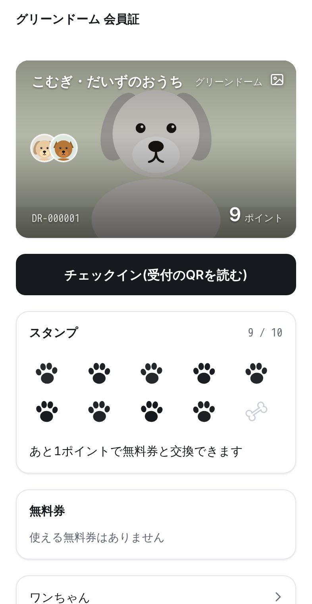 | 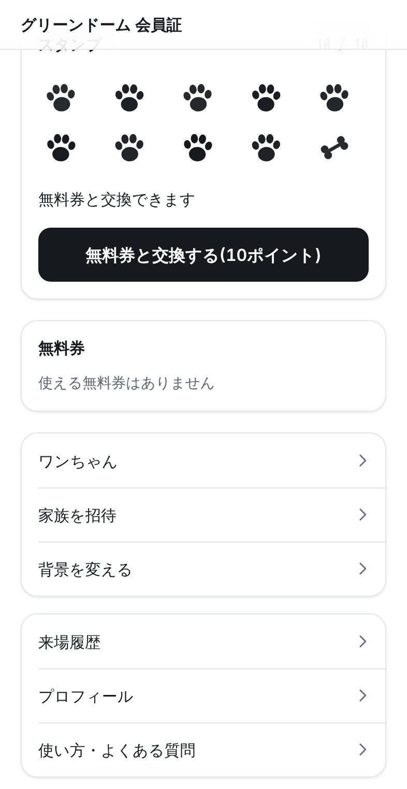 |

- 会員証には、おうちの呼び名・会員ID・ワンちゃん・ポイントが出ます。
- ポイントと、無料券と交換できるまであと何ポイントかが分かります。ポイントは10をこえても、そのままたまります(自動で無料券にはなりません。交換は下の「無料券と交換する」で)。
- 会員証の下の「スタンプ」に、たまったポイントの数だけ肉球のスタンプが押されます。10個目は骨のしるしです。10個をこえた分は「11個目から」として下の段に続きます。新しくたまったスタンプは、開いたときに押す動きをします。
- 「来場履歴」で、これまでの来場と、無料券の交換・使用の記録が見られます。

### 会員証の背景を変える

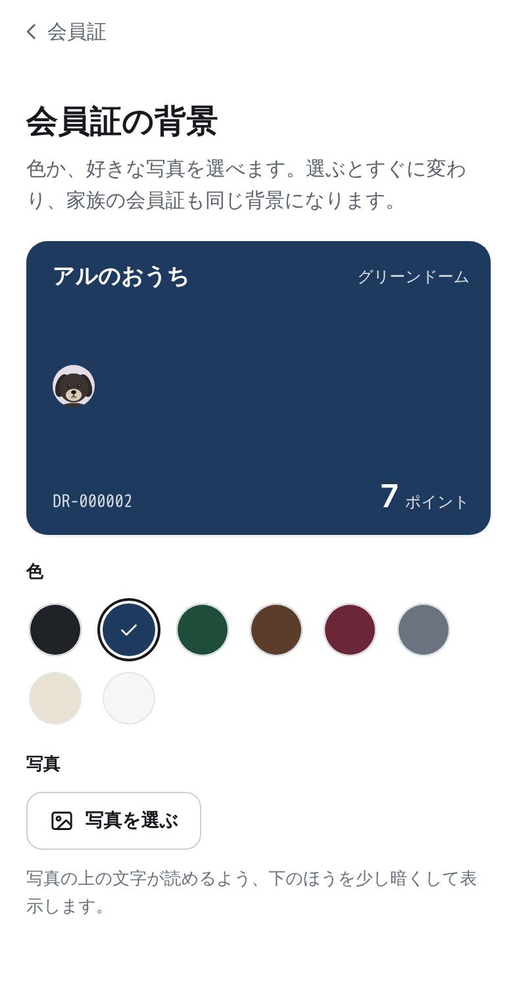

1. 会員証の右上の写真のしるし、または下のメニューの「背景を変える」を押します。
2. 8色の中から色を選ぶか、「写真を選ぶ」で好きな写真を選びます。選ぶとすぐに変わります(保存のボタンはありません)。
3. 写真をやめるときは「写真をやめる」を押します。

- 背景は、ご家族の会員証も同じになります。
- 写真の上でも名前と会員IDが読めるよう、写真の下のほうを少し暗くして表示します。写真はスマホの中で小さくしてから送ります。

### 無料券と交換する

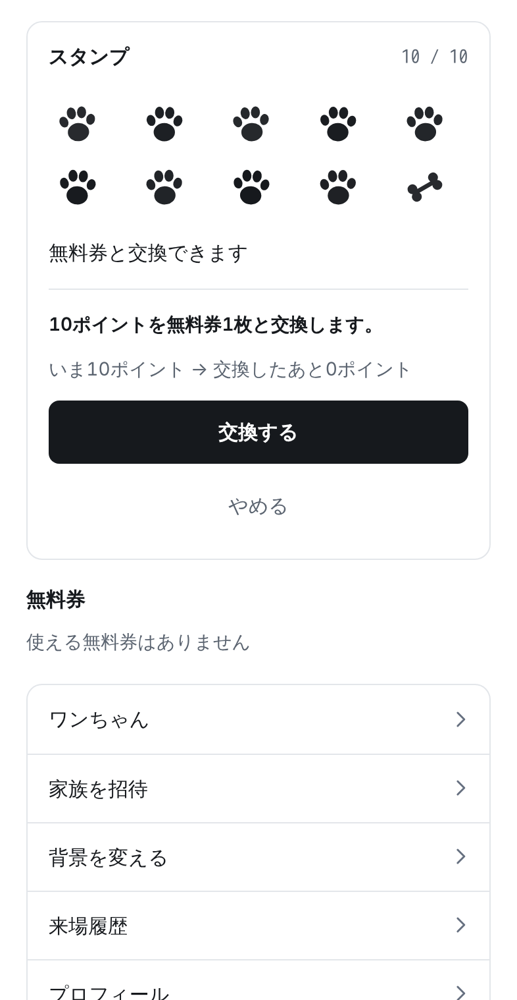

1. ポイントが10以上になると、会員証の下の「スタンプ」の欄に「無料券と交換する(10ポイント)」のボタンが出ます。
2. 押すと「10ポイントを無料券1枚と交換します。」と出るので、「交換する」を押します。
3. 会員証の「無料券」の欄に、無料券が1枚増えます(「未使用 1枚」)。交換した無料券は、すぐに使えます。

### 無料券を使用する

1. 受付で、会員証の「無料券」の欄を、スタッフに見せます。
2. 「スライドして使用する」の左のつまみを、指で右端まで動かします(昔の iPhone のロック解除と同じ動きです)。途中で指を離すと元に戻り、使われません。
3. 「使用できました」の画面(時計が動いています)を、受付で見せてください。来場1回分が無料になります。使うと元に戻せません。

| 右へスライドする | 使用できました |
| --- | --- |
| 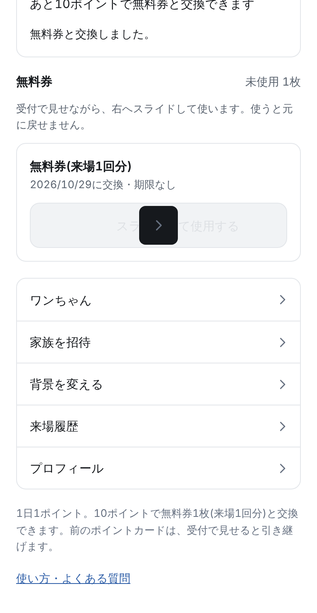 | 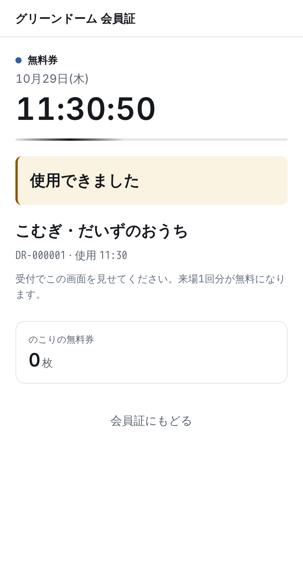 |

- チェックインの前でも後でも使えます。その日のチェックインと結びつきます。
- 使った画面をもう一度見せるときは、会員証の「今日使った無料券の画面を見る」を押します。
- 間違えて押してしまったときは、受付にお知らせください。

### ワンちゃんを追加する・変える

1. 会員証の下のメニューの「ワンちゃん」を押します。
2. 追加するときは「ワンちゃんを追加する」を押し、写真・名前・犬種・サイズを入れて「追加する」を押します。
3. 変えるときは、その子の行を押します。写真・名前・性別・生まれた年月を変えられます。「体重・相性・予防注射」を開くと、体重・ほかの犬との相性(得意・ふつう・苦手)・狂犬病の予防注射と混合ワクチンの年(いちばん最近に受けた年)も入れられます。どれも入れなくてかまいません。
4. 「保存する」を押します。

- 犬種とサイズは、受付で変えます。間違っているときは、受付にお知らせください。

| ワンちゃんの変更 | 登録をおやすみする |
| --- | --- |
| 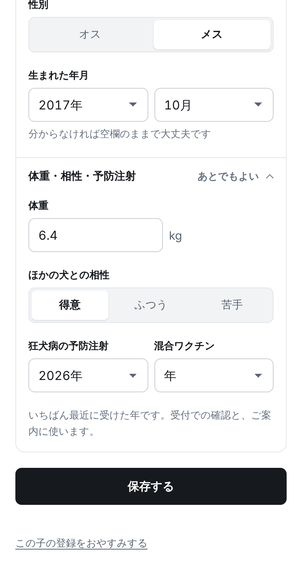 | 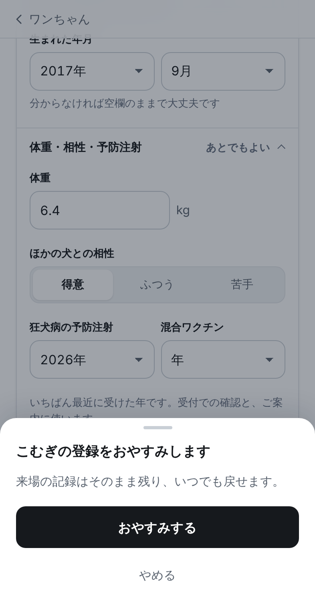 |

しばらく来ない子は、ワンちゃんの変更画面の一番下の「この子の登録をおやすみする」を押し、「○○の登録をおやすみします。来場の記録はそのまま残り、いつでも戻せます。」と出たら「おやすみする」を押します。チェックインの選択肢に出なくなります。戻すときは、「ワンちゃん」の画面の下の「おやすみ中のワンちゃん」で「戻す」を押します。

### プロフィール

会員証の下のメニューの「プロフィール」で、アンケートの答えを変えられます。「あなたについて」(年代・性別)は一人ひとり、「おうちについて」(郵便番号・知ったきっかけ・ふだんの来場手段・来たい時間帯・興味のあるイベント・ほかのドッグランも使っているか・お知らせを受け取るか)はご家族で共通です。来たい時間帯と興味のあるイベントは、いくつでも選べます。必ず答えるのは年代・性別・知ったきっかけだけで、ほかは答えなくてもかまいません。変えたら「保存する」を押します。

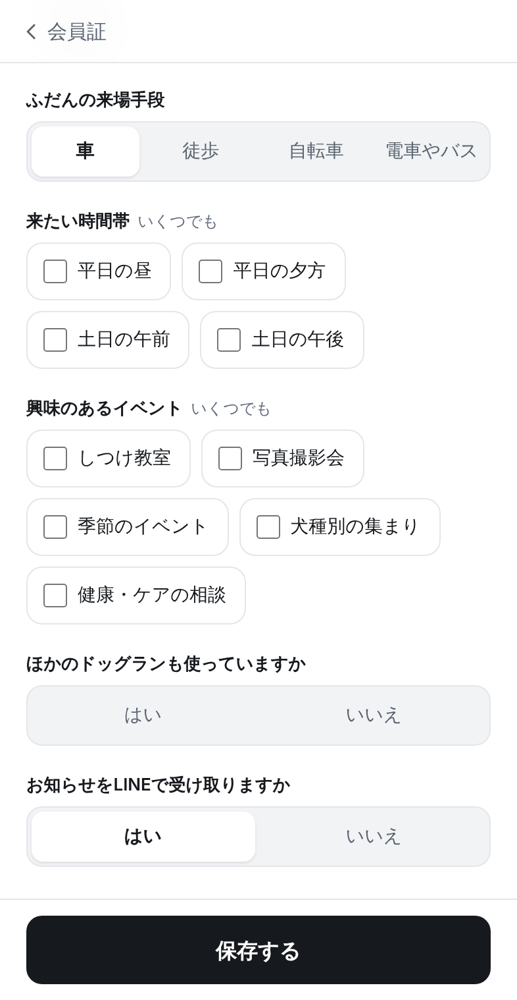

- まだ答えていない質問があるときは、会員証の下に小さく「答える」が出ます。そこからも開けます。

## 4. ご家族を招待する

ご家族が同じ会員証を使うと、誰がチェックインしても同じ会員証にポイントがたまります。

1. 会員証の「家族を招待」を押します。
2. 「LINEで招待を送る」を押し、送りたいご家族を選んで送ります。ご家族がそばにいるときは「招待のQRコードを表示する」を押し、ご家族の LINE のカメラで読み取ってもらいます。
3. ご家族が招待を開き、年代・性別を選んで、「同意します」に印を付けて「参加する」を押します。
4. 「参加しました」と出たら完了です。ご家族の会員証にも、同じ会員ID・ポイント・ワンちゃんが出ます。

| 招待を送る | 招待を受けたご家族の画面 |
| --- | --- |
| 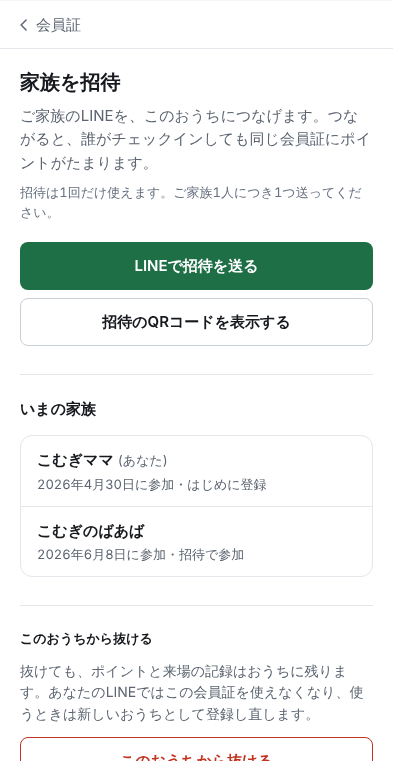 | 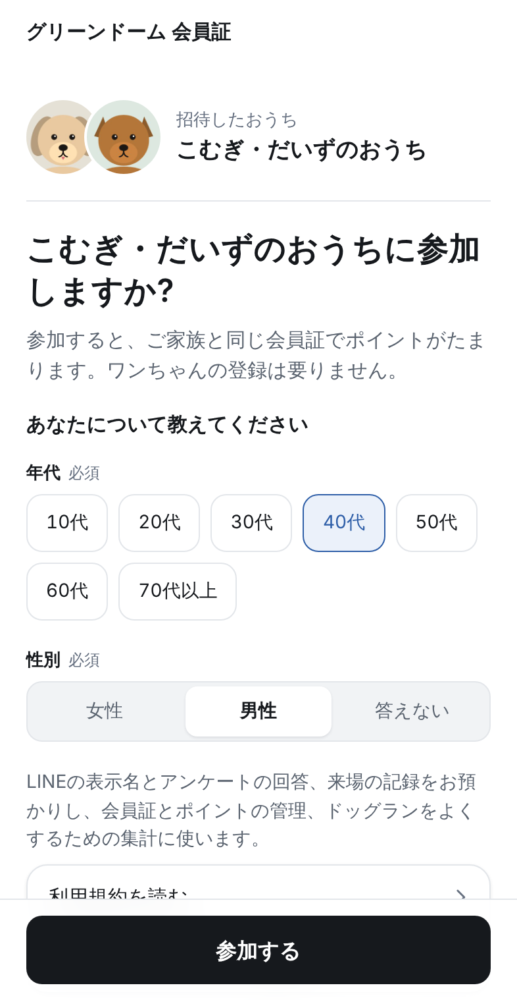 |

- 招待は24時間有効で、1回だけ使えます。ご家族1人につき1つ送ってください。
- ご家族がすでに別の会員証でポイントをためているときも、同じ招待を開くだけで、2つのおうちを1つにまとめられます(4.1)。
- 受付で、家族を追加する QR コードを出してもらうこともできます。

### 4.1 別々にためていた会員証を1つにまとめる

ご家族が別々に登録して、ポイントが2つの会員証に分かれてしまったときは、片方の方が「家族を招待」で招待を送り、もう片方の方が開くと、その場で1つにまとめられます。受付の確認は要りません。

1. 招待を開くと、「おうちを一つにまとめる」の画面が出ます。まとめた後の会員ID・ポイントの合計・来場の記録・ご家族が表示されます。
2. 「あなたのワンちゃん」で、招待したおうちにも同じ子が登録されていれば、その子を選びます。同じ子は1頭にまとまります。両方に写真があるときは、残す写真を選べます。違う子なら「いない」のままにします。
3. 「まとめる」を押すと、確認の画面が出ます。「○○さんのおうちと一つになります。ポイントは合計 N ポイントになり、あなたの会員IDは DR-000123 になります。」と内容を確かめて、もう一度「まとめる」を押します。
4. 「おうちが一つになりました」と出たら完了です。新しい会員IDとポイントが表示されます。

| おうちを一つにまとめる | まとめてよいですか? | まとまりました |
| --- | --- | --- |
| 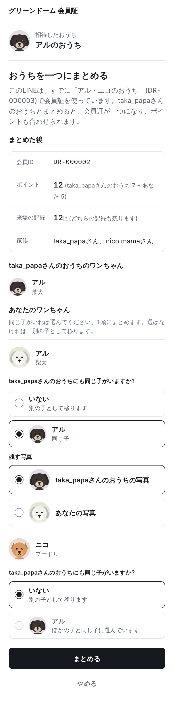 | 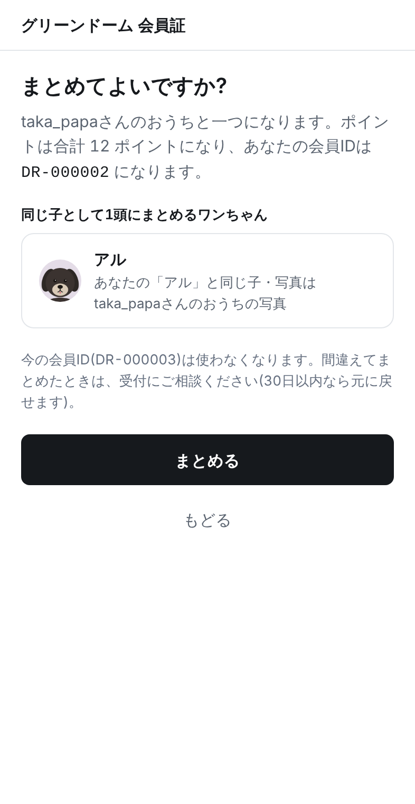 | 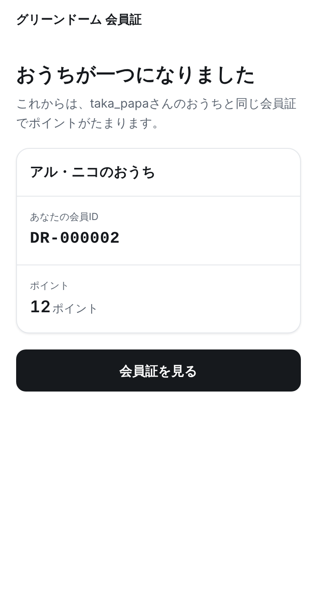 |

- 残るのは、招待を送った方の会員IDです。招待を開いた方の会員IDは使わなくなります。
- ポイントは合計され、来場の記録もすべて残ります。
- 招待を開いた方のおうちに、ほかのご家族がいるときは、その方も一緒に移ります。その方が次に会員証を開くと、「おうちが一つになりました」とお知らせが出ます。
- まとめるのをやめるときは「やめる」を押します。何も変わらず、今の会員証のままです。
- 間違えてまとめたときは、受付にご相談ください。30日以内なら元に戻せます。
- 受付で出してもらう「家族を追加」の QR コードを読み取っても、同じようにまとめられます。

## 5. 前のカードのポイントを引き継ぐ

LINE のショップカードと、紙のスタンプカードのポイントを引き継げます。引き継ぎは受付だけで行います(LINE からの申請はありません)。

1. 来場のときに、受付で前のカードを見せてください(LINE のショップカードは、その画面を見せてください)。
2. 受付でカードを確かめて、会員証のポイントに加えます。
3. 紙のスタンプカードは、受付でお預かりします(または使用済みの印を押してお返しします)。

- カードの種類ごとに1回ずつ引き継げます。一度に引き継げるポイントには上限があります。
- 引き継げる期間は、店頭やLINEでお知らせします。

## 困ったときは

会員証が開かない、ポイントが合わない、ご家族のつなぎ方が分からないなど、困ったときは受付のスタッフにお知らせください。会員証の下の「使い方・よくある質問」にも説明があります。
