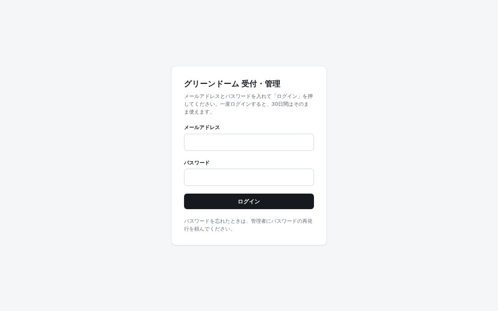
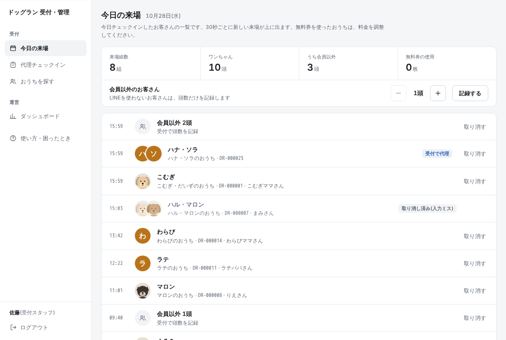
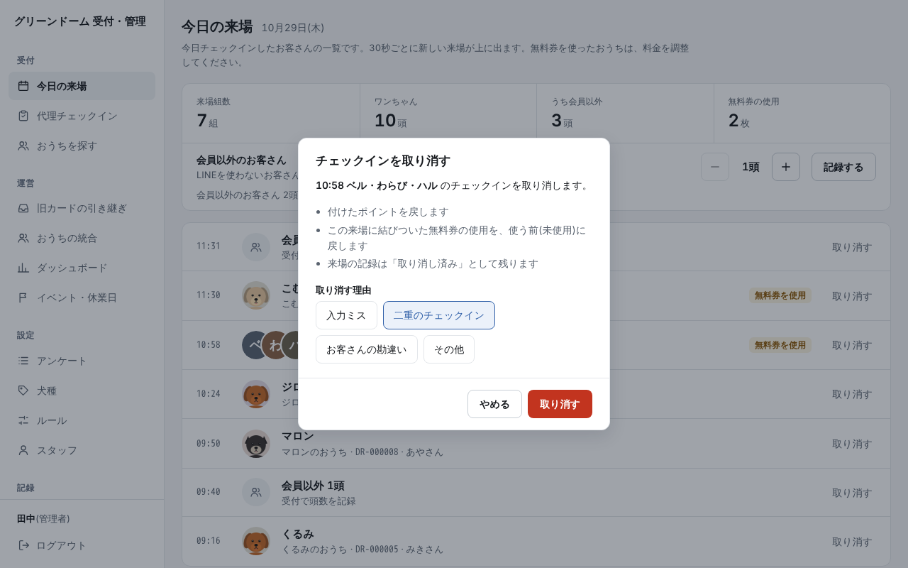
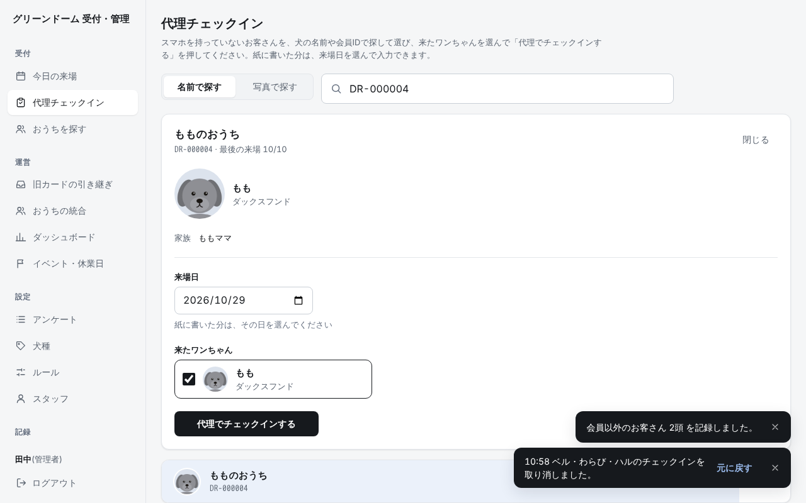
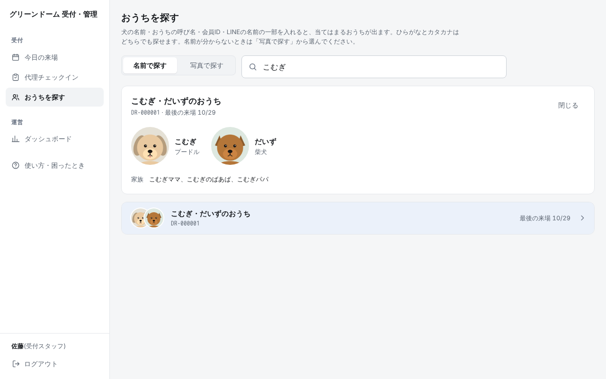
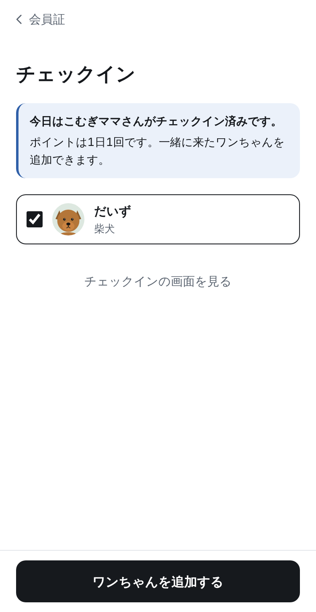

# 操作マニュアル(受付スタッフ用)

受付のタブレットで使う画面の説明です。くわしい説明は [管理者用のマニュアル](manual-admin.md) にあります。写真はデモの画面で、名前や数字は架空のものです。

## 1. ログイン

1. 受付のタブレットで、管理画面を開きます。
2. 管理者から受け取った「メールアドレス」と「パスワード」を入れます。
3. 「ログイン」を押します。

一度ログインすると、30日間はそのまま使えます。パスワードを忘れたときは、管理者に再発行を頼んでください。

## 2. 今日の来場

1. ログインすると「今日の来場」が出ます。
2. お客さんがチェックインすると、一覧の一番上に出ます(30秒ごとに新しくなります)。
3. お客さんのスマホの「チェックイン完了」の画面と、一覧の名前が合っているかを確かめます。
4. 「無料券を使用」の印があるおうちは、料金を無料にします。

完了の画面の時計が動いていないときは、写真(スクリーンショット)かもしれません。もう一度チェックインの画面を開いてもらってください。

## 3. 取り消し

1. 「今日の来場」で、間違えた行の右の「取り消す」を押します。
2. 「取り消す理由」を選びます。
3. 右下の「取り消す」を押します。

ポイントと無料券は元に戻り、行に「取り消し済み」と出ます。取り消した日は、お客さんがもう一度チェックインできます。取り消せないと出たときは、管理者に相談してください。

## 4. 会員以外

LINE を使わないお客さんは、頭数だけを記録します。

1. 「今日の来場」の「会員以外のお客さん」で、「−」「+」を押して頭数を合わせます。
2. 「記録する」を押します。

## 5. 代理チェックイン

スマホを持っていない、または受付の QR コードが読めないお客さんを、受付がチェックインします。

1. メニューの「代理チェックイン」を押します。
2. 犬の名前か会員IDを入れ、出てきたおうちの行を押します。
3. 「来たワンちゃん」で、今日来た子にだけ印を付けます。無料券を使うときは「無料券を使う」にも印を付けます。
4. 「代理でチェックインする」を押します。

紙に書いておいた日の分は、「来場日」でその日を選んでから入力します。

## 6. おうちを探す

1. メニューの「おうちを探す」を押します。
2. 犬の名前・おうちの呼び名・会員ID・LINE の名前の一部を入れます(ひらがなでもカタカナでも探せます)。
3. 出てきた行を押すと、ワンちゃんの写真と家族が出ます。

名前が分からないときは「写真で探す」を押し、ワンちゃんの写真から選びます。

## 7. お客さんに聞かれたときの答え方

**「ポイントが付かない」**
ポイントは、おうちごとに1日1ポイントです。家族の誰かが今日もうチェックインしていると、ポイントは増えず、一緒に来たワンちゃんを追加するだけになります。「今日の来場」でそのおうちを確かめてください。付け忘れのときは、管理者がポイントを足せます。

**「無料券はどうやって使うの」**
10ポイントたまると、無料券が1枚出ます。次の来場から使えます。チェックインのときに「無料券を使う」を選ぶと、完了の画面に「無料券を使用」と大きく出ます。無料券を使った日も、1ポイントたまります。

**「家族も同じ会員証を使える?」**
使えます。会員証の「家族を招待」から、LINE で招待を送ってもらってください。参加すると、誰がチェックインしても同じ会員証にポイントがたまります。家族が別々に登録してしまったときは、片方の方に「家族を招待」で招待を送ってもらい、もう片方の方が開いて「まとめる」を押すと、その場で1つにまとまります(ポイントは合計されます)。お客さんが操作できないときは、受付で管理者がまとめることもできます。

**「ワンちゃんの写真や名前を変えたい」**
写真・名前・性別・生まれた年月は、お客さんが会員証の「ワンちゃん」から変えられます。犬種とサイズは管理者が変えるので、管理者に伝えてください。写真を登録していない子は、名前の頭文字の絵が出ます。

## 8. 困ったとき

- 画面のメニューの「使い方・困ったとき」に、よくある質問があります。
- 画面が動かないときは、まず画面を読み込み直してください。直らないときは、来たお客さんを紙に書いておき、あとで代理チェックインで「来場日」を選んで入力します。
- 分からないこと、取り消せないこと、名前や犬種の直しは、管理者に伝えてください。
