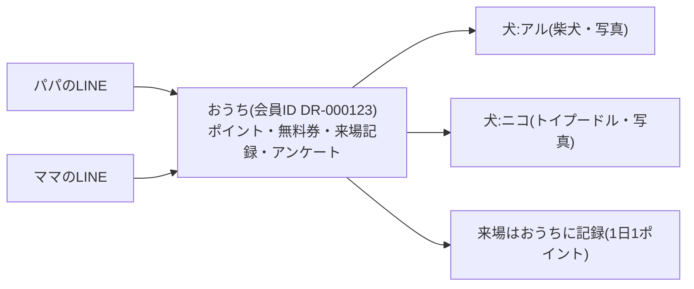
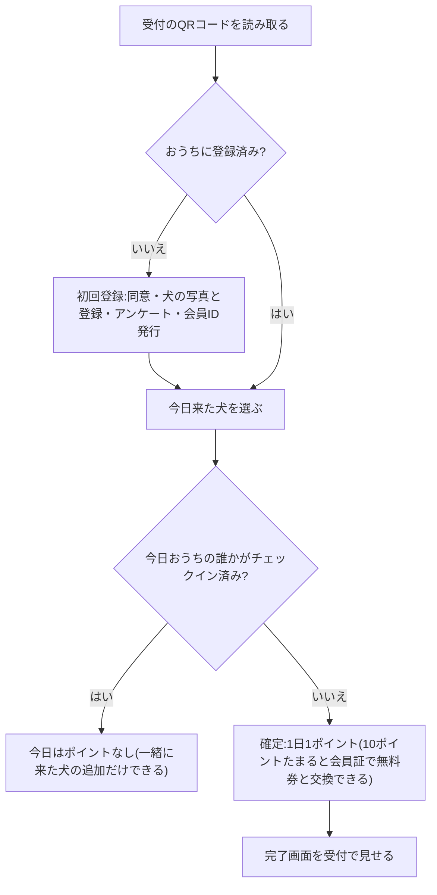
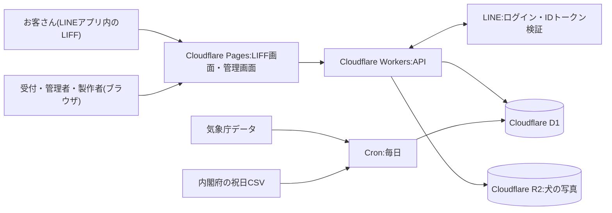
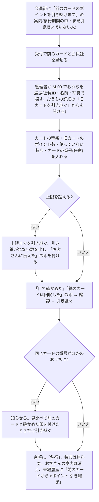

# ドッグラン LINE会員・分析システム 要件定義書

Oct 28, 2026 · @bandvape

LINE公式アカウントの標準ショップカードを、自前のLINEミニアプリ(LIFF)と管理画面に置き換えます。ポイントは「おうち」(家族)単位でためるため、パパとママのLINEアカウントが別でも、同じおうちとしてポイントがたまります。犬は写真つきで登録し、管理者は「アルくん・ニコちゃんのおうち」のように犬の名前と写真でお客さんを見分けられます。

ITに詳しくない管理者が、製作者の手を借りずに日々の運用をすべて行えることを目標にします。月額費用は0円で運用できる見込みです。

> この文書は、Claude Codeが実装に使う仕様書を兼ねています。機能ID(例:C-04)は、実装のタスク・テスト・受け入れ確認で共通に使います。

## 1. 概要・目的・スコープ

**解決したい課題**

- 標準ショップカードでは、会員ごとの来場履歴をシステムの外に取り出せない。そのため、リピート率を計算できない。
- 家族が別々のLINEアカウントで来場すると、同じ家の犬なのにポイントが分かれてしまう。
- 管理者はお客さんを犬の名前で覚えているが、LINEの表示名では誰か分からない。
- 天気・曜日・イベントと来場者数の関係や、来場者の属性(犬種・飼い主の年代など)が分からない。

**ゴール**

- 友だち約1,000人を、新しい会員証へ移行する。今後の会員増にも対応する。
- 家族の複数のLINEアカウントを1つの「おうち」にまとめ、ポイントを合算できるようにする。
- 犬を写真つきで登録し、管理者が犬の名前と写真でお客さんを探せるようにする。
- お客さんの操作はLINEの中だけで完結させる。
- ITに詳しくない管理者が、製作者の手を借りずに日々の運用をすべて行えるようにする。
- 管理者が、ブラウザでいつでも分析結果を確認できるようにする。
- 月額の運用費を、原則0円にする。

**スコープ**

| 区分 | 内容 |
| --- | --- |
| 対象 | 会員登録(会員ID発行・犬の写真と情報の登録・アンケート)、家族の連携、おうちの統合とポイントの合算、チェックイン、ポイントと無料券、会員証、来場履歴、受付画面、管理画面、分析ダッシュボード、天気・祝日の自動取得、旧カードからの移行 |
| 対象外 | 売上の管理(料金の計算・記録・集計)、決済、予約、複数店舗の管理、LINEのメッセージ自動配信 |
| 将来の拡張候補 | 売上の記録、休眠しているおうちへのLINE配信、予約、複数店舗。データ設計は、これらを後から追加できる形にしておく |

## 2. 前提条件と決定事項

| 項目 | 決定内容 |
| --- | --- |
| ポイントの単位 | 「おうち」(家族)ごとにためる。会員IDもおうちごとに1つ |
| ポイント | おうちごとに1日1ポイント(何頭で来ても、家族の誰がチェックインしても1ポイント)。10ポイントで無料券1枚(来場1回分が無料)と交換できる。交換はお客さんが会員証で押す |
| 家族の連携 | 1つのおうちに、複数のLINEアカウントを登録できる。お客さん同士の招待でも、管理者の操作でもつなげられる |
| おうちの統合 | 別々にためていたおうちを、1つにまとめられる。お客さん同士なら招待を開いた人が本人の確認だけでまとめ、受付では管理者がまとめる。ポイントと無料券は合算し、同じ犬は1頭にまとめる |
| 犬の登録 | 写真・名前・犬種などを登録する。来場はすべて、登録した犬単位で記録する |
| 料金(参考) | 1頭目600円、2頭目300円。システムでは料金を計算・記録・表示しない。支払いは従来どおり受付で行う |
| お客さんの操作 | LINEの中だけで完結させる。ウェブサイトへのログインやパスワードは使わない |
| 運用 | 日々の運用は管理者だけで行う。製作者はデータベースと内部監査だけを担当する |
| 不正対策 | 性善説で運用する。受付の固定QRコードを、お客さんが自分で読み取ってチェックインする。同じおうちの同じ日の二重チェックインだけはシステムで防ぐ |
| 受付の確認 | チェックイン完了画面を受付で見せてもらう。現在時刻と動く表示で、スクリーンショットと見分けられるようにする |
| 非会員 | LINEを使わないお客さんは、受付で頭数だけを手入力する。来場者数の集計には含める |
| 設計の方針 | 運用しながら変えたくなる項目(アンケートの質問、犬種の選択肢、無料券に必要なポイント数、有効期限など)は、プログラムを変えずに管理画面から変えられるようにする |
| 月額費用 | 原則0円。無料プランで商用利用ができるサービスだけを使う |
| 規模 | おうち1万件、来場記録10万件、犬の写真2万枚まで、構成を変えずに動くこと |
| 開発 | 実装はClaude Codeが行う。この文書を仕様の正とする |
| 納期 | 指定なし。品質を優先し、フェーズごとに確認しながら進める |

## 3. 役割と運用方針

### 3.1 4つの役割

| 役割 | 誰か | 使うもの | 担当すること |
| --- | --- | --- | --- |
| お客さん | ドッグランの利用者 | LINEだけ | 会員登録、犬の写真の登録、家族の招待、チェックイン、ポイントの確認、無料券との交換と使用 |
| 受付スタッフ(任意) | 受付に立つ人 | 管理画面(タブレット) | 今日の来場の確認と取り消し、非会員の入力、犬の名前でのおうち検索 |
| 管理者 | ドッグランの運営者 | 管理画面(タブレット・PC) | 日々の運用のすべて。ポイントの手動登録、名前・写真の変更、家族の連携、おうちの統合、移行の承認、イベント・休業日・アンケートの設定、スタッフの管理、分析の確認 |
| 製作者 | あなた | Cloudflare・GitHub・管理画面(閲覧のみ) | データベースへのアクセス、内部監査(操作ログの確認)、バックアップからの復元、障害対応、プログラムの更新。日々の運用には関わらない |

### 3.2 権限

| 機能 | お客さん | 受付スタッフ | 管理者 | 製作者 |
| --- | --- | --- | --- | --- |
| 自分のおうちの会員証・ポイント・来場履歴 | ○ | ― | ― | ― |
| 今日の来場一覧・取り消し・非会員の入力 | ― | ○ | ○ | 閲覧のみ |
| おうちの検索(犬の名前・写真・会員ID・LINEの表示名) | ― | ○ | ○ | 閲覧のみ |
| ダッシュボード | ― | ○ 集計値のみ | ○ | 閲覧のみ |
| おうちの詳細(アンケートの回答) | ― | ― | ○ | 閲覧のみ |
| ポイント・無料券の手動登録、名前・写真・犬種の変更 | ― | ― | ○ | ― |
| 家族の連携・解除、おうちの統合 | △ 招待からの参加・まとめる(5.1)、自分が抜ける(5.4) | ― | ○ | ― |
| 旧カードの引き継ぎ(受付での直接入力)、イベント・休業日・アンケート・各種設定、スタッフの管理 | ― | ― | ○ | ― |
| 操作ログの閲覧 | ― | ― | ○ | ○ |
| システムの状態(天気の取得、バックアップ、エラー) | ― | ― | ○ 簡易表示 | ○ 詳細 |
| データベースへの直接アクセス、復元 | ― | ― | ― | ○ |

### 3.3 管理者だけで運用するための方針

- **毎日やることはない**:天気・祝日の取得、集計、有効期限の処理、バックアップはすべて自動で動く。
- **必要な操作はすべて管理画面にある**:ポイントの手動登録、名前や写真の変更、家族の連携、統合、設定の変更に、製作者の作業やデータベースの操作は要らない。
- **間違えても戻せる**:ポイントの調整、取り消し、統合、名前や写真の変更は、管理画面から元に戻せる(統合は30日以内)。データの完全な削除は、管理画面ではできない。
- **専門用語を使わない**:画面の言葉は「おうち」「ポイント」「無料券」など、管理者がふだん使う言葉にそろえる。
- **画面ごとに使い方を表示する**:各画面に、短い使い方の説明と、よくある質問へのリンクを置く。
- **製作者が呼ばれるのは例外だけ**:障害、データの復元、プログラムの変更が必要なとき。その連絡先は管理画面の「困ったとき」に表示する。

## 4. おうち・家族・犬の考え方

ポイント・無料券・会員ID・来場記録は、すべて「おうち」に付きます。家族それぞれのLINEアカウントと、飼っている犬は、おうちにつながります。



| 言葉 | 意味 | 例 |
| --- | --- | --- |
| おうち | ポイントをいっしょにためる単位。会員IDはおうちごとに1つ | アル・ニコのおうち(DR-000123) |
| 家族 | おうちにつながっているLINEアカウント。何人でもよい | パパのLINE、ママのLINE |
| 犬 | おうちで飼っている犬。写真・名前・犬種などを持つ | アル(柴犬)、ニコ(トイプードル) |
| おうちの呼び名 | 管理画面での表示名。犬の名前から自動で作る(例:アル・ニコのおうち)。管理者が自由に変更できる | アルくん・ニコちゃんのおうち |

**会員ID**

- おうちの最初の登録が完了した時点で発行する。形式は `DR-` + 6桁の連番(例:DR-000123)。
- 一度発行したIDは変更・再利用しない。統合で使われなくなったIDは、統合先のIDへの案内として残す。
- 家族が増えても会員IDは変わらない。機種変更しても、同じLINEアカウントならそのまま使える。

**犬ID**

- 犬ごとに付ける(例:DR-000123-1)。来場記録は犬IDで残し、犬種別の分析に使う。

## 5. 家族の連携と、おうちの統合・ポイントの合算

家族をつなぐ方法は3つあります。お客さん同士の招待で済むことが多く、「すでに別々にポイントをためていた家族」も、招待を開いた人が本人の確認だけでまとめられます。管理者の手作業は、受付でまとめるときだけです。

| 場面 | 方法 | 操作する人 |
| --- | --- | --- |
| 家族がまだ会員ではない | お客さん同士の招待(5.1) | お客さんだけ |
| お客さんが招待の操作をできない | 受付のタブレットに出した招待QRを読み取ってもらう(5.2) | 管理者が画面を出し、お客さんが読み取る |
| 家族がすでに別のおうちでポイントをためていた | 招待を開いて、その場でまとめる(5.1)。受付でまとめるときは、おうちの統合(5.3) | お客さんだけ(受付では管理者) |

### 5.1 お客さん同士の招待(LINEだけで完結)

1. 会員証の「家族を招待」を押す。LINEのトークで家族に招待を送るか、招待用のQRコードを家族に読み取ってもらう。
2. 家族がLINEで招待を開くと、「アル・ニコのおうちに参加しますか?」と表示される。参加を押すと完了する。
3. 家族がはじめての場合は、本人のアンケート(年代・性別)だけ答えてもらう。犬の登録は要らない。
4. 招待は24時間有効で、1回だけ使える。
5. 家族がすでに別のおうちでポイントをためている場合は、参加ではなく「おうちを一つにまとめる」画面を出し、本人の確認だけでその場でまとめる(管理者の確認は待たない)。招待を作った側の同意は、招待を送ったこと自体とみなす。
   - 画面には、まとめた後の内容(残る会員ID = 招待した側、ポイントの合計、来場の回数、家族、両方のワンちゃん)を見せる。
   - 自分のワンちゃんごとに「招待した側にも同じ子がいるか」を選べる。同じ子なら1頭にまとめ(名前と犬種は招待した側のまま)、両方に写真があれば、残す写真を選ぶ。選ばなければ別の子として移す。
   - 「まとめる」→ 確認(「○○さんのおうちと一つになります。ポイントは合計 N ポイントになり、あなたの会員IDは DR-XXXXXX になります。」)→ 完了(「おうちが一つになりました」)。「やめる」なら何も変えない。
   - 処理は管理者の統合(5.3)と同じ。操作ログには、お客さんの操作(まとめた人の名前)として残る。元に戻すのは、管理者が30日以内に操作ログから(5.3 と同じ条件)。
   - 自分のおうちに自分以外の家族がいれば、その人も一緒に移る。その人には、次に会員証を開いたとき「おうちが一つになりました」と1回だけ知らせる。
   - 招待は、まとめた時点で使い切り。期限切れ・使用済みの招待、招待したおうちがすでに統合済み・退会のときは、まとめられない(「受付にご相談ください」と出す)。受付の招待QR(5.2)から開いた場合も同じ。
   - 以前の「おうちをまとめる申請」(管理者の確認待ち)は作らない。

### 5.2 受付での連携

管理画面のおうちの詳細で「家族を追加」を押すと、10分間だけ有効な招待QRコードがタブレットに表示されます。家族がLINEのカメラで読み取ると、そのおうちに参加します。読み取った人がすでに別のおうちを持っていれば、5.1 と同じく、その場でまとめられます。

### 5.3 おうちの統合(管理者)

お客さん同士なら、招待を開いた人が自分でまとめられる(5.1)。この画面は、受付でまとめるときに使う。お客さんがまとめた場合も、処理(下の合算のルールと元に戻す条件)はこの統合と同じ。

1. 犬の名前や写真で、まとめたい2つのおうちを探して選ぶ。
2. 残す会員IDを選ぶ(初期値は、登録が古い方)。
3. 両方の犬の写真が並んで表示されるので、同じ犬どうしを組み合わせる。
4. まとめた後の結果(家族・犬・ポイント・無料券)を確認する。
5. 「まとめる」を押す。

**合算のルール**

| 対象 | 統合したときの扱い |
| --- | --- |
| ポイント | 両方の残高を合計する。10以上になっても、無料券には自動で替えない(8章。交換はお客さんが会員証で押す) |
| 無料券 | 両方の未使用分をそのまま引き継ぐ |
| 家族 | 全員を、残す方のおうちに移す |
| 犬 | 「同じ犬」と組み合わせた犬は1頭にまとめ、来場記録も1頭分にまとめる。写真・名前・犬種は、管理者が選んだ方を残す(お客さんがまとめたときは、名前・犬種は招待した側、写真は選んだ方) |
| 来場記録 | すべて残す方のおうちに移す。統合前に、同じ日に両方のおうちが来場していた分も、そのまま残す(ポイントは減らさない) |
| 旧カードからの移行 | 両方の移行記録を残す |
| 使わなくなった会員ID | 「統合済み」として残す。管理画面でそのIDを検索すると、統合先を表示する |
| 元に戻す | 統合から30日以内で、統合後にそのおうちの来場・ポイントの変更がない場合に限り、管理画面から統合前の状態に戻せる(お客さんがまとめたものも同じ)。変更がある場合は、管理画面に「製作者に依頼してください」と表示する |
| 知らせる | まとめられた側の家族(まとめた本人を除く)に、次に会員証を開いたとき「おうちが一つになりました」と1回だけ表示する |

### 5.4 家族の解除

- お客さんは会員証の画面から、管理者は管理画面から、家族をおうちから外せる。
- 外れてもポイントはおうちに残る。外れた人は、新しいおうちとして登録し直せる。
- おうちに残る最後の1人は外せない(退会の扱いにする)。

### 5.5 家族が同じ日に来たとき

おうちのポイントは1日1ポイントです。家族の誰かがすでにチェックインしている日は、ほかの家族がLIFFを開くと「今日はパパがチェックイン済みです」と表示します。その画面から、一緒に来た犬を追加することだけができます(ポイントは増えない)。

## 6. 犬の写真と登録情報

犬は写真つきで登録してもらい、管理画面では写真と名前を中心にお客さんを表示します。管理者は、LINEの表示名を知らなくても、犬の名前や写真でおうちを探せます。

### 6.1 犬の登録項目

| 項目 | 必須 | 入力方法 | 変更できる人 |
| --- | --- | --- | --- |
| 写真 | 推奨(後からでもよい) | LINEの中で、カメラで撮るか写真を選ぶ | お客さん・管理者 |
| 名前 | ○ | 自由入力(20文字まで) | お客さん・管理者 |
| 犬種 | ○ | 一覧から選ぶ(大まかな分け方。下の一覧)。ない場合は「その他」で自由入力 | 管理者のみ(変更履歴を残す) |
| サイズ | ○ | 小型・中型・大型(犬種から初期値を自動で選ぶ) | 管理者のみ |
| 性別 | 任意 | オス・メス | お客さん・管理者 |
| 生まれた年月 | 任意 | 年と月を選ぶ(分からなければ空欄) | お客さん・管理者 |
| 体重 | 任意 | kg、小数1桁(0.1〜100.0) | お客さん・管理者 |
| ほかの犬との相性 | 任意 | 得意・ふつう・苦手(小型犬だけの時間帯などの運営に使う) | お客さん・管理者 |
| 狂犬病の予防注射の年 | 任意 | 年を選ぶ(2000年〜今年。受付での確認と案内に使う) | お客さん・管理者 |
| 混合ワクチンの年 | 任意 | 年を選ぶ(2000年〜今年) | お客さん・管理者 |

- 体重・相性・予防注射の年(2026-10-28 に追加)は、登録の画面では「体重・相性・予防注射(あとでもよい)」の欄にたたんで置き、答える負担を増やさない。

- 犬種とサイズをお客さんが変更できないのは、分析を登録時の情報で一貫させるためです。間違いは管理者が直します。
- 犬種は「ミニチュアダックスフンド」ではなく「ダックスフンド」のように、大枠でまとめます(2026-10-28 の打ち合わせで決定)。初期の選択肢は、日本で多い順に次の26件です: プードル、チワワ、ダックスフンド、ポメラニアン、柴犬、フレンチブルドッグ、ミニチュアシュナウザー、ヨークシャーテリア、マルチーズ、シーズー、ゴールデンレトリバー、パピヨン、コーギー、ジャックラッセルテリア、ラブラドールレトリバー、ペキニーズ、ボーダーコリー、キャバリア、パグ、ビーグル、ボストンテリア、ミニチュアピンシャー、イタリアングレーハウンド、バーニーズマウンテンドッグ、ミックス、その他。選ぶ画面もこの順で、「ミックス」「その他」が最後です。
- 犬種の選択肢は、管理者が管理画面で追加・名前の変更・並べ替え・非表示にできます。
- すでに登録していた細かい犬種(トイプードル、カニンヘンダックスフンド、ロングコートチワワなど)は、大まかな犬種にまとめました。犬の犬種は付け替えて変更履歴に残し、古い犬種は削除せずに非表示にしています(マイグレーション 0007)。
- しばらく来ない犬は、登録を「おやすみ」にできます(画面の言葉は「この子の登録をおやすみする」「おやすみ中」。犬の変更画面の一番下に小さく置き、見出しや説明は付けない)。確認の文は「○○の登録をおやすみします。来場の記録はそのまま残り、いつでも戻せます。」。過去の来場記録は残し、チェックインの選択肢には出しません。お客さん(「おやすみ中のワンちゃん」の「戻す」)と管理者(「登録に戻す」)が、いつでも戻せます。
- 登録を「解除」する、死や別れを表す言葉は、画面に出しません(2026-10-28 の打ち合わせで決定)。

### 6.2 写真の扱い

- お客さんのスマホの中で、長い辺が800ピクセルになるよう縮小してから送る(1枚あたり約150KB)。一覧表示用の小さな画像(正方形)も作る。
- 保存先はCloudflare R2。2万枚でも約3GBで、無料枠の10GBに収まる。
- 写真は、そのおうちの家族と、受付スタッフ・管理者・製作者だけが見られる。外部に公開するURLは作らない。
- 管理者は、写真の差し替え・向きの回転・削除ができる。
- 写真がない犬は、犬種と名前の頭文字で作った絵を代わりに表示する。

### 6.3 管理画面での見え方

- 今日の来場一覧、おうちの検索結果、おうちの詳細に、犬の写真と名前を大きく表示する。
- おうちの検索は、犬の名前・おうちの呼び名・会員ID・家族のLINE表示名のどれでもできる。受付スタッフも同じ。ひらがなとカタカナの違いは区別しない。
- 「写真で探す」画面では、最近来たおうちの犬の写真を一覧で並べる。

## 7. アンケートの項目と分析での使い道

アンケートは、答える負担を1分以内に抑えます(選ぶだけ。必須は年代・性別・きっかけ、犬の名前・犬種・サイズのみ)。分析の軸になる項目は固定し、それ以外の質問は管理者が管理画面で追加・変更できるようにします。

### 7.1 固定の質問(分析の軸になる)

| 聞く相手 | 質問 | 選択肢 | 必須 | 分析での使い道 |
| --- | --- | --- | --- | --- |
| 家族一人ひとり | 年代 | 10代・20代・30代・40代・50代・60代・70代以上 | ○ | 来場者の年代構成、年代別のリピート率 |
| 家族一人ひとり | 性別 | 女性・男性・答えない | ○ | 来場者の構成 |
| おうち(最初の1人) | お住まいの郵便番号 | 7桁の数字 | 任意 | 来場者がどこから来ているか。チラシや広告を出す地域の判断 |
| おうち(最初の1人) | このドッグランを知ったきっかけ | Instagram・Googleマップ・知人の紹介・通りがかり・ほかのドッグランで聞いた・その他 | ○ | 集客で効いている経路 |
| おうち(最初の1人) | ふだんの来場手段 | 車・徒歩・自転車・電車やバス | 任意 | 駐車場の需要 |
| おうち(最初の1人) | 来たい時間帯(いくつでも) | 平日の昼・平日の夕方・土日の午前・土日の午後 | 任意 | 営業時間・イベントの時間帯の判断 |
| おうち(最初の1人) | 興味のあるイベント(いくつでも) | しつけ教室・写真撮影会・季節のイベント・犬種別の集まり・健康・ケアの相談 | 任意 | 企画するイベントの判断 |
| おうち(最初の1人) | ほかのドッグランも使っていますか | はい・いいえ | 任意 | 競合の利用状況 |
| おうち(最初の1人) | お知らせをLINEで受け取りますか | はい・いいえ | 任意 | 将来のLINE配信の同意 |
| 犬ごと(6.1) | 犬種・サイズ・生まれた年月・体重・ほかの犬との相性・予防注射の年 | 6章のとおり | 犬種・サイズは必須 | 犬種・サイズ別の来場、シニア犬向けイベントの需要、相性に配慮した時間帯 |

- おうちへの質問は、最初の1人が登録のときに答え、あとから家族の誰でもプロフィール(C-09)で変えられる。管理者もおうちの詳細(M-06)で変えられる(操作ログに残り、元に戻せる)。
- 来たい時間帯・興味のあるイベント・ほかのドッグラン・お知らせ(2026-10-28 に追加)は任意。登録の画面では「よければ教えてください」の欄にまとめる。すでに登録しているお客さんには、7.2 の「1回だけ表示」はせず、会員証の下に小さく「答える」「あとで答える」を出すだけにする(どれか1つに答えると出なくなる。「あとで答える」はその端末で30日間出さない)。
- 「はい・いいえ」の質問は、回答を 1 / 0 で保存するため、管理画面では文だけ変えられる(選択肢は変えられない)。

### 7.2 管理者が追加できる質問

- 例:「ほかのドッグランを使っていますか」「来てほしいイベントは」など。
- 選択式(1つ選ぶ)・複数選択(いくつでも選ぶ)・自由記述を作れる。質問の追加・並べ替え・非表示は、管理画面からできる。複数選択の集計は、選んだ選択肢ごとに数える。
- 追加した質問の回答は、管理画面の集計とCSV出力に自動で出る。
- 既存の会員には、次にLIFFを開いたときに1回だけ表示する(答えなくても使える)。

## 8. ポイント・特典ルール

| ルール | 内容 |
| --- | --- |
| 付与 | おうちごとに1日1ポイント。何頭で来ても、家族の誰がチェックインしても1ポイント。チェックインの確定と同時に付与する |
| 犬の記録 | ポイントとは別に、その日に来た犬を必ず記録する。頭数と犬種の分析に使う |
| 無料券を使った日 | ほかの日と同じように1ポイントを付ける(管理画面の設定で変えられる) |
| 無料券との交換 | ポイントは10を超えてもたまり続ける。無料券は自動では発行しない。10ポイント以上あるときに、お客さんが会員証の「無料券と交換する」を押すと(確認つき)、10ポイントを引いて無料券を1枚発行する。台帳には「無料券と交換」(マイナス10)の行を書く。同時に押されても、残高を超えて交換しない |
| 無料券の使用 | お客さんが会員証の無料券を、受付で見せながら右へスライドして使う(昔の iPhone のロック解除と同じ操作。右端まで動かすと使い、途中で離すと戻る。キーボードでも操作できる。使うと元に戻せない)。「使用できました」の画面(おうちの呼び名・会員ID・動く現在時刻つき)が出て、受付はそれを見て料金を調整する。その日の来場があれば、その来場に結びつける(チェックインがあとなら、チェックインのときに結びつける)。チェックインの画面では無料券を選ばない。スマホがないときは、受付・管理者がおうちの詳細(M-06)で「使用済みにする」を押す(操作ログから元に戻せる) |
| 有効期限 | ポイント・無料券ともに管理画面で設定できる。初期値は現行のショップカードに合わせる(要確認) |
| 二重チェックインの防止 | 同じおうちが同じ日に2回チェックインしようとしたら、2回目はポイントを付けない(5.5) |
| 手動の登録 | 管理者は、ポイントと無料券を手動で増やす・減らすことができる。理由の入力を必須にし、後から元に戻せる。統合・旧カードの引き継ぎ・手動の登録でポイントが10以上になっても、無料券には自動で替えない |
| 旧カードから引き継いだポイント | 台帳に「移行」(移行元つき)として足すだけで、来場には数えない(来場の記録・日別の集計・分析は増えない)。旧カードの使っていない特典(LINEショップカードの特典チケットなど)は、ポイントを引かずに無料券(発行のもと「移行」)にする(16.1) |
| 取り消し | チェックインを取り消すと、付与したポイントを戻し、その来場に結びついた無料券の使用は未使用に戻す(ほかの日に使った券は戻さない)。以前の記録で、その来場でたまって自動で発行された無料券があれば回収し、その券がすでに使われている場合は取り消せない。取り消した日は、もう一度チェックインできる |
| 交換した無料券 | 交換した無料券は、すぐに使える。無料券を使った日の印(今日の来場の「無料券を使用」)は、その日・そのおうちで使った券から出す |
| 台帳 | ポイントと無料券の増減はすべて台帳に記録し、残高は台帳から計算する |
| 変えられる設定 | 無料券と交換するのに必要なポイント数、有効期限、1日の上限ポイント数は、管理画面から変えられる |

## 9. 機能要件

機能は全44個です。「必須」の32個で運用を始められ、「推奨」の12個は予算と時間に応じて追加します。

### 9.1 お客さん向け(LINEの中のLIFFアプリ)

| ID | 機能 | 内容 | 優先度 |
| --- | --- | --- | --- |
| C-01 | 初回登録 | LINEログイン、利用規約とプライバシーポリシーへの同意、会員IDの発行 | 必須 |
| C-02 | 犬の登録 | 写真・名前・犬種など(6.1)。初回は1頭以上の登録を必須にする | 必須 |
| C-03 | アンケート | 7.1の固定の質問と、管理者が追加した質問 | 必須 |
| C-04 | チェックイン | 受付のQRコードから開く → 来た犬を選ぶ → 確定(無料券はここでは選ばない。会員証の右へスライドして使う) | 必須 |
| C-05 | 完了画面 | 犬の写真と名前、会員ID、付与したポイント、その日に無料券を使ったか、現在時刻。背景を動かし、スクリーンショットと見分けられるようにする | 必須 |
| C-06 | 会員証 | おうちの呼び名、会員ID、犬の写真、ポイント、施設名、肉球のスタンプ、無料券と交換できるまでのポイント、「無料券と交換する」(10ポイント以上のとき)、保有している無料券と、右へスライドして使う部品(使うと「使用できました」の画面)。会員証の背景はお客さんが選べる(単色8色か自分の写真。おうちで共通。docs/design.md 5章) | 必須 |
| C-07 | 来場履歴 | 日付、来た犬、チェックインした家族、獲得ポイント、無料券の交換と使用 | 推奨 |
| C-08 | 犬の管理 | 写真・名前の変更、犬の追加、登録のおやすみと戻す操作 | 必須 |
| C-09 | プロフィール | 自分のアンケート回答の変更 | 推奨 |
| C-10 | (廃止)旧カードの引き継ぎ申請 | お客さんからの申請はやめた。旧カードは受付で見せてもらい、管理者が直接入力する(A-05、16.1) | ― |
| C-11 | 家族の招待 | LINEのトークで招待を送る、または招待QRを表示する(5.1) | 必須 |
| C-12 | 招待からの参加・おうちをまとめる | 招待を開いて、おうちに参加する。すでに別のおうちがある場合は、まとめた後の内容を確かめて、本人の確認だけでその場でまとめる(5.1) | 必須 |
| C-13 | 家族の一覧 | おうちの家族を見る。自分がおうちから抜ける | 推奨 |

### 9.2 受付スタッフ向け(管理画面・タブレット)

| ID | 機能 | 内容 | 優先度 |
| --- | --- | --- | --- |
| S-01 | ログイン | メールアドレスとパスワード。30日間ログイン状態を保つ | 必須 |
| S-02 | 今日の来場 | 時刻、犬の写真と名前、おうちの呼び名、無料券の使用(その日・そのおうちで使った券から出す)。30秒ごとに自動更新 | 必須 |
| S-03 | 取り消し | チェックインの取り消し。付けたポイントと、その来場に結びついた無料券の使用を元に戻す | 必須 |
| S-04 | 代理チェックイン | スマホを持っていないお客さんを、犬の名前で探してチェックインする。日付を指定して後から入力することもできる | 推奨 |
| S-05 | 非会員の入力 | 頭数だけを記録する | 必須 |
| S-06 | おうちの検索 | 犬の名前・おうちの呼び名・会員IDで探す。写真の一覧から探す | 必須 |

### 9.3 管理者向け

| ID | 機能 | 内容 | 優先度 |
| --- | --- | --- | --- |
| A-01 | ダッシュボード | 13章の指標。期間(24時間・7日・30日・90日・12か月・期間を選ぶ)を切り替え、前の同じ長さの期間と比べる。日ごとのカレンダー(天気・来場・イベント・メモ)と日の詳細、天気ごとの来場、どこから来ているか(郵便番号から市区町村)、日々のメモ。各パネルの数字を CSV で出せる(docs/design.md 12章) | 必須 |
| A-02 | おうちの一覧と詳細 | 呼び名と犬の写真で一覧表示。詳細には家族、犬、来場履歴、アンケートの回答、ポイント台帳、無料券。呼び名の変更。無料券を使用済みにする(受付・管理者。元に戻せる) | 必須 |
| A-03 | ポイントの手動登録 | ポイントと無料券を増やす・減らす。理由は選択式(イベント特典、お詫び、入力ミスの修正、その他)。元に戻せる | 必須 |
| A-04 | 犬の情報の変更 | 写真・名前・犬種・サイズなどの変更。犬種とサイズは変更履歴を残す。登録のおやすみと、登録に戻す操作 | 必須 |
| A-05 | 旧カードの移行 | 受付での直接入力だけ(対面)。「旧カードを目で確かめた」「紙のカードは回収した(または使用済みの印を付けた)」の印を必須にし、引き継げるポイントの上限(設定)を超えるものは入力できない(上限を超えるカードは上限までを引き継ぐ)。使っていない特典は無料券にする(上限は設定)。カードの番号を入れると、同じ番号のカードがほかのおうちで引き継がれていないかを知らせる。移行期間のまとめ(引き継いだおうちの数・ポイントの合計・終わりまでの日数)と、切り替えの手順(M-19)。引き継ぎ済みの一覧(会員ID・呼び名・カードの番号で探せる)から元に戻せる | 必須 |
| A-06 | 家族の追加・解除 | 招待QRを表示して家族を追加する(5.2)。家族を外す | 必須 |
| A-07 | おうちの統合 | 受付で2つのおうちをまとめる(5.3)。ポイントの合算、同じ犬の組み合わせ、30日以内なら元に戻せる(お客さんが招待からまとめたものも、操作ログから元に戻せる) | 必須 |
| A-08 | (廃止)まとめる申請の確認 | お客さんが招待から自分でまとめる形(C-12)になったため、なくした。以前の申請の行は残すが、確認待ちには出さない | ― |
| A-09 | イベント・休業日 | イベントの日付と名前、臨時休業日の登録 | 必須 |
| A-10 | アンケートの管理 | 質問の追加・並べ替え・非表示(7.2)。答え方は選ぶ・いくつでも選ぶ・自由に書く | 推奨 |
| A-11 | 犬種の選択肢の管理 | 選択肢の追加・名前の変更・並べ替え・非表示(大まかな分け方。6.1) | 推奨 |
| A-12 | ルールの設定 | 施設の名前(画面の「グリーンドーム 会員証」「グリーンドーム 受付・管理」に出す)、無料券と交換するのに必要なポイント数、有効期限、1日の上限ポイント数、リピート率・休眠の判定日数、旧カードから引き継げるポイントの上限、旧カードの特典から出せる無料券の上限、移行期間のあとの引き継ぎを受け付けるか | 推奨 |
| A-13 | スタッフの管理 | 受付スタッフのアカウントの追加・停止、パスワードの再発行 | 必須 |
| A-14 | CSV出力 | おうち、家族、犬、来場、ポイント台帳、アンケートの回答。AI に渡す分析パック(1日1行)とおうちごとの表(個人情報なし)。すべての CSV の先頭に「#」の説明行(施設名・出力日時・期間・各列の意味・注意・使い方)を付け、列名は日本語と単位。説明行を付けないこともできる | 推奨 |
| A-15 | 操作ログと元に戻す | 誰がいつ何を変えたかの一覧。直近の操作は、ここから元に戻せる | 必須 |
| A-16 | 使い方と「困ったとき」 | 各画面の使い方、よくある質問、製作者への連絡方法 | 必須 |
| A-17 | システムの状態(簡易) | 天気の取得とバックアップが正常かを、青(正常)・黄・赤で表示する | 推奨 |

### 9.4 製作者向け

| ID | 機能 | 内容 | 優先度 |
| --- | --- | --- | --- |
| D-01 | 閲覧専用アカウント | 管理画面のすべてを閲覧できるが、変更はできない。内部監査に使う | 必須 |
| D-02 | システムの状態(詳細) | エラーの記録、自動処理の実行履歴、データ量と無料枠の使用状況 | 推奨 |

データベースへの直接アクセスと、バックアップからの復元は、Cloudflareの管理画面で製作者が行います。手順は運用・保守の手順書にまとめます。

### 9.5 自動処理

| ID | 機能 | 内容 | 優先度 |
| --- | --- | --- | --- |
| B-01 | 天気の取得 | 毎朝、前日の天気・最高気温・最低気温・降水量を気象庁のデータから取得する。失敗したら翌日に取り直す | 必須 |
| B-02 | 祝日の取り込み | 内閣府の祝日データを年1回取り込む | 必須 |
| B-03 | 日別集計 | チェックインと取り消しのたびに更新し、毎晩全体を再計算して確認する | 必須 |
| B-04 | バックアップ | データベースを毎日エクスポートして30日分保存する | 必須 |
| B-05 | 有効期限の処理 | 期限が切れたポイントと無料券を、毎晩失効させる | 推奨 |
| B-06 | 移行用の画像の削除 | 移行期間が終わったら、以前に届いた引き継ぎ申請の写真を削除する | 推奨 |
| B-07 | 郵便番号から地域を調べる | まだ調べていない郵便番号だけを、郵便番号の検索サービス(zipcloud)で都道府県・市区町村・町域に変えて覚えておく。1回 30件まで、1件ごとに間を空ける。インターネットにつながらない環境(デモ)では飛ばす | 推奨 |

## 10. 画面一覧とチェックインの流れ

画面は全32画面です(お客さん向け13、受付・管理者向け19)。

### 10.1 お客さん向け(LIFF)

| 画面ID | 画面 | 主な機能ID |
| --- | --- | --- |
| L-01 | 同意・はじめての方へ | C-01 |
| L-02 | 犬の登録(写真つき) | C-02、C-08 |
| L-03 | アンケート | C-03 |
| L-04 | 登録完了(会員IDの表示) | C-01 |
| L-05 | チェックイン | C-04 |
| L-06 | チェックイン完了 | C-05 |
| L-07 | 会員証(無料券との交換と使用、「使用できました」の画面、前のカードの引き継ぎの案内を含む) | C-06 |
| L-07b | 会員証の背景を変える | C-06 |
| L-08 | 来場履歴(前のカードからの引き継ぎの記録を含む) | C-07 |
| L-09 | 犬の管理 | C-08 |
| L-10 | プロフィール | C-09 |
| L-11 | 家族(招待・一覧) | C-11、C-13 |
| L-12 | 招待を受けたときの画面 | C-12 |
| L-13 | (廃止)旧カードの引き継ぎ申請 | C-10 |

### 10.2 受付・管理者向け(ブラウザ。タブレットで使いやすい大きさ)

| 画面ID | 画面 | 主な機能ID | 使う人 |
| --- | --- | --- | --- |
| M-01 | ログイン | S-01 | 全員 |
| M-02 | 今日の来場(ホーム画面) | S-02、S-03、S-05 | 全員 |
| M-03 | 代理チェックイン | S-04 | 受付・管理者 |
| M-04 | おうちを探す(名前・写真) | S-06 | 全員 |
| M-05 | ダッシュボード | A-01 | 全員(受付は集計値のみ) |
| M-06 | おうちの詳細 | A-02、A-03、A-06 | 管理者 |
| M-07 | 犬の編集 | A-04 | 管理者 |
| M-08 | おうちの統合 | A-07 | 管理者 |
| M-09 | 旧カードの引き継ぎ(直接入力・引き継ぎ済みの一覧)。以前の確認待ち | A-05 | 管理者 |
| M-10 | イベント・休業日 | A-09 | 管理者 |
| M-11 | アンケートの設定 | A-10 | 管理者 |
| M-12 | 犬種の選択肢 | A-11 | 管理者 |
| M-13 | ルールの設定 | A-12 | 管理者 |
| M-14 | スタッフ | A-13 | 管理者 |
| M-15 | 操作ログ | A-15 | 管理者・製作者 |
| M-16 | 使い方・困ったとき | A-16 | 全員 |
| M-17 | システムの状態 | A-17、D-02 | 管理者・製作者 |
| M-18 | CSV出力 | A-14 | 管理者 |
| M-19 | 切り替えの手順(旧カードから新しい会員証へ。16.3) | A-05、A-16 | 管理者・製作者 |

管理画面のトップは「今日の来場」にし、確認待ちがあるときは件数を目立つ場所に表示します。

### 10.3 チェックインの流れ

LIFFを開いた時点で、そのLINEアカウントがどのおうちの家族かを判定し、未登録の人だけを初回登録に案内します。リッチメニューから開いた場合は、L-07 会員証を表示します。



2回目以降は、QRを読み取ってから犬を選んで確定するだけで完了します。無料券を使う日は、会員証の無料券を受付で見せながら右へスライドします(チェックインの前でも後でもよい)。

## 11. データ設計

データベースはCloudflare D1(SQLite互換)で、テーブルは26個です(11.5 の staff\_sessions と system\_jobs、11.2 の migration\_cards、11.4 の postal\_areas と day\_notes を含む。写真をデータベースに保存するときの media\_objects は数えない)。犬の写真などの画像はCloudflare R2に保存し、データベースには保存先のキーだけを持ちます。日時はすべて日本時間で扱います。

### 11.1 おうち・家族・犬

| テーブル | 役割 | 主な項目 |
| --- | --- | --- |
| households | おうち | 会員ID(DR-000123)、呼び名、呼び名を自動で作るか、登録日時、登録経路(新規/移行)、郵便番号、知ったきっかけ、来場手段、来たい時間帯(JSONの配列)、興味のあるイベント(JSONの配列)、ほかのドッグランの利用(1/0)、お知らせの受け取り(1/0)、会員証の背景(JSON。単色の名前か写真のキー。空なら墨)、状態(有効/統合済み/退会)、統合先の会員ID |
| family\_members | 家族(LINEアカウント) | 家族ID、会員ID、LINEユーザーID(一意)、LINE表示名、年代、性別、参加日時、参加方法(初回登録/招待/受付/統合)、状態、前のカードの案内を閉じた日時 |
| invites | 家族の招待 | 招待コード、会員ID、作った人、種類(家族から/受付で)、有効期限、使った家族ID |
| dogs | 犬 | 犬ID(DR-000123-1)、会員ID、名前、写真のキー、一覧用の小さな写真のキー、犬種、サイズ、性別、生まれた年月、体重(kg)、ほかの犬との相性(得意/ふつう/苦手)、狂犬病の予防注射の年、混合ワクチンの年、状態(登録中/おやすみ中/統合済み。内部の値は active / retired / merged)、統合先の犬ID |
| dog\_changes | 犬の情報の変更履歴 | 犬ID、項目、変更前、変更後、理由、変更した人、日時 |
| breeds | 犬種の選択肢 | 犬種名、標準のサイズ、並び順、表示するか |

### 11.2 来場・ポイント・統合

| テーブル | 役割 | 主な項目 |
| --- | --- | --- |
| visits | 来場(1回のチェックインで1行) | 来場ID、会員ID(非会員は空)、チェックインした家族ID、来場日、日時、頭数、無料券を使ったか、登録方法(本人/代理/非会員入力)、取り消し日時・理由。「会員ID+来場日」を一意にする(非会員と取り消し済みを除く) |
| visit\_dogs | 来場した犬 | 来場ID、犬ID、来場日 |
| point\_ledger | ポイント台帳 | 会員ID、増減、種類(来場/無料券と交換/取り消し/移行/手動/統合/失効)、関係する来場ID・無料券・統合、移行元(LINEのショップカード/紙のスタンプカード)、理由、操作した人、日時、有効期限、打ち消した元の行(元に戻したとき)、同じ操作の印(手動登録を元に戻すため) |
| tickets | 無料券 | 券ID、会員ID、発行日時(交換した日時)、有効期限、発行のもと(ポイントと交換/手動/統合/移行)、使った日時、使った来場ID、状態(未使用/使用済/失効/取り消しで回収)、メモ、同じ操作の印(手動登録を元に戻すため)、交換の印(二重に交換しないため) |
| migration\_cards | 旧カードの引き継ぎの入力の記録(16.1) | 会員ID、移行元、引き継いだポイント、旧カードに残っていたポイント(上限で切る前)、特典から出した無料券の枚数、カードの番号(任意)と探す用の形、メモ、移行期間のあとに受け付けた理由、同じ番号のカードがあると分かって入力したときのその会員ID、操作ログの番号、入力した人、日時、元に戻した日時・人。残高には使わない(残高は point\_ledger から計算する)。行は消さない |
| merges | おうちの統合 | 統合ID、残した会員ID、まとめた会員ID、犬の組み合わせ、統合前の状態の記録(元に戻すため)、実行した人(管理者、またはお客さん = 家族ID と使った招待)、日時、元に戻した日時 |
| requests | 確認待ち | 種類(旧カードの移行/おうちをまとめる ※どちらも以前の行だけ。いまは作らない)、会員ID、まとめる相手の会員ID、申請した家族、内容、添付画像のキー、添付画像を消した日時、状態(確認待ち/承認/却下)、処理した人、日時、処理のメモ |

### 11.3 アンケート

| テーブル | 役割 | 主な項目 |
| --- | --- | --- |
| survey\_questions | 質問 | 質問ID、聞く相手(家族/おうち)、形式(選択/複数選択/自由記述)、選択肢、並び順、表示するか、固定の質問か。複数選択は kind = 'choice' と multiple = 1 で表す(kind の制約を変えないため) |
| survey\_answers | 回答 | 質問ID、家族IDまたは会員ID、回答(複数選択はJSONの配列)、日時 |

### 11.4 分析用

| テーブル | 役割 | 主な項目 |
| --- | --- | --- |
| daily\_stats | 日別の集計 | 日付、来場組数、来場頭数(会員/非会員)、新規おうち数、初来場のおうち数、使われた無料券の枚数 |
| daily\_weather | 日別の天気 | 日付、天気、最高気温、最低気温、降水量、日照時間、観測地点、出典 |
| calendar | 日付の属性 | 日付、曜日、祝日名、曜日区分(平日/土曜/日曜/祝日)、臨時休業、休業の理由 |
| events | イベント | 日付、名前、種類、メモ、消した日時(行は消さない) |
| postal\_areas | 郵便番号から調べた地域 | 郵便番号(7桁)、都道府県、市区町村、町域、見つかったか(見つからない番号も残して調べ直さない)、調べ先、調べた日時 |
| day\_notes | 日々のメモ | 日付、本文(500文字まで)、書いた人・日時、直した人・日時、消した日時(行は消さない)。1日に何件でも |

### 11.5 管理用

| テーブル | 役割 | 主な項目 |
| --- | --- | --- |
| settings | 設定(項目名と値の組) | 無料券に必要なポイント数、1日の上限ポイント数、無料券を使った日のポイント、有効期限、判定日数、受付QRの合言葉、招待の有効時間、移行期間、旧カードから引き継げるポイントの上限、旧カードの特典から出せる無料券の上限、移行期間のあとの引き継ぎを受け付けるか、統合で同じ日のポイントを残すか、製作者の連絡先、利用規約・プライバシーポリシーの本文、天気の観測地点、LINEミニアプリの番号 |
| staff\_users | 管理画面の利用者 | メールアドレス、名前、パスワードのハッシュ、権限(受付スタッフ/管理者/製作者・閲覧のみ)、状態、最終ログイン、ログインの失敗回数、ロックの解除日時 |
| staff\_sessions | ログイン状態 | ログインの印(ハッシュ)、利用者、ログイン日時、有効期限(30日)、ログアウト日時 |
| audit\_log | 操作ログ | 操作した人、操作の種類、対象、変更前後、理由、日時、元に戻すための情報、元に戻した日時・人 |
| system\_jobs | 自動処理の実行の記録 | 処理の種類(天気/祝日/日別集計/バックアップ/有効期限/移行用の画像の削除/郵便番号から地域を調べる)、始まりと終わりの日時、結果(実行中/成功/一部だけ/失敗)、結果の説明 |

売上の項目は今回は持ちません。将来追加する場合は、visitsに料金の列を足すだけで対応できる形にしておきます。

## 12. API一覧

APIは、メソッドごとに数えて全107本です(お客さん向け39本、管理画面向け68本。動作確認用の /api/health は数えない)。施設の名前だけを返す /api/public-settings と /admin/api/public-settings は、ログインの前の画面でも使うため認証なしです。お客さん向けはLINEのIDトークンをサーバー側で毎回検証し、管理画面向けはログインのセッションで認証します。権限はすべてサーバー側で確認します。

### 12.1 お客さん向け(認証:LINE IDトークン)

| メソッド | パス | 内容 | 機能ID |
| --- | --- | --- | --- |
| GET | /api/me | 登録済みか、所属するおうち、会員証の情報 | C-01、C-06 |
| GET | /api/breeds | 犬種の選択肢 | C-02、C-08 |
| POST | /api/register | 同意・アンケート・犬を受け取り、おうちと会員IDを作る | C-01〜C-03 |
| GET / POST | /api/dogs | 犬の一覧、犬の追加 | C-08 |
| PATCH | /api/dogs/:id | 犬の名前などの変更 | C-08 |
| POST | /api/dogs/:id/photo | 犬の写真の登録・差し替え | C-02、C-08 |
| POST | /api/dogs/:id/retire | 犬の登録をおやすみする | C-08 |
| POST | /api/dogs/:id/restore | おやすみ中の犬を登録に戻す | C-08 |
| GET / POST | /api/survey | 未回答の質問の取得、回答 | C-03 |
| GET / PATCH | /api/me/profile | 自分のアンケート回答の表示・変更 | C-09 |
| GET | /api/checkins/today | チェックイン画面の表示内容(今日すでにおうちの誰かがチェックインしていれば、その来場) | C-04 |
| POST | /api/checkins | 受付QRの合言葉・犬IDを受け取り、チェックインする(無料券はここでは使わない) | C-04 |
| GET | /api/checkins/:id | 完了画面の表示内容 | C-05 |
| POST | /api/checkins/:id/dogs | 同じ日に家族が来たとき、犬を追加する | C-04 |
| GET | /api/me/visits | 来場履歴 | C-07 |
| POST | /api/invites | 家族の招待を作る | C-11 |
| GET | /api/invites/:code | 招待の内容(おうちの呼び名・犬の写真)。別のおうちがある人には、まとめた後の下見 | C-12 |
| GET | /api/invites/:code/photos/:dogId | 招待の画面に出す犬の写真(一覧用の小さな写真) | C-12 |
| POST | /api/invites/:code/accept | 招待を受けて参加する(別のおうちがある人は、まとめる方へ進む) | C-12 |
| POST | /api/invites/:code/merge | 招待を開いた人が、本人の確認でおうちをまとめる(同じ子と残す写真を受け取る) | C-12 |
| GET | /api/merge-notice | 「おうちが一つになりました」のお知らせ(まだ見ていなければ) | C-12 |
| POST | /api/merge-notice/seen | お知らせを見た | C-12 |
| GET | /api/me/oldcard | 前のカードの引き継ぎの案内(移行期間の中で、まだ引き継いでおらず、閉じていないときだけ)と、引き継いだ記録 | C-06、C-07 |
| POST | /api/me/oldcard/close | 前のカードの案内を閉じる(その家族 = LINEアカウントだけ) | C-06 |
| GET | /api/family | 家族の一覧 | C-13 |
| POST | /api/family/leave | 自分がおうちから抜ける | C-13 |
| POST | /api/tickets/exchange | 無料券と交換する(10ポイント以上のとき。二重に送られても1枚) | C-06 |
| POST | /api/tickets/:id/use | 無料券を使う(自分のおうちの未使用の券だけ。その日の来場に結びつける。サーバーの時刻を返す) | C-06 |
| GET | /api/tickets/:id | 「使用できました」の画面の内容 | C-06 |
| GET | /api/tickets/history | 無料券の交換と使用の記録 | C-07 |
| GET | /api/media/:key | 自分のおうちの犬の写真と、会員証の背景の写真(ほかのおうちの写真は 403) | C-06 |
| GET / PUT | /api/me/card-background | 会員証の背景の取得、単色を選ぶ(家族の誰でも。操作ログに残す) | C-06 |
| POST / DELETE | /api/me/card-background/photo | 会員証の背景に写真を使う(JPEG・PNG・WebP、2MB まで。スマホで 1200px 以下に縮小して送る)、写真をやめる(墨に戻す。写真のファイルは消さない) | C-06 |
| GET | /api/public-settings | 施設の名前(認証なし) | C-06 |

### 12.2 管理画面向け(認証:ログインのセッション)

| メソッド | パス | 内容 | 機能ID | 権限 |
| --- | --- | --- | --- | --- |
| POST | /admin/api/login、/admin/api/logout | ログイン・ログアウト | S-01 | 全員 |
| GET | /admin/api/me | ログイン中の利用者 | S-01 | 全員 |
| GET | /admin/api/today | 今日の来場一覧 | S-02 | 全員 |
| POST | /admin/api/checkins/:id/cancel | チェックインの取り消し | S-03 | 受付・管理者 |
| GET | /admin/api/checkins/proxy/status | 代理チェックインの前に、その日のチェックインと使える無料券を確かめる | S-04 | 受付・管理者 |
| POST | /admin/api/checkins/proxy | 代理チェックイン | S-04 | 受付・管理者 |
| POST | /admin/api/walkins | 非会員の頭数の記録 | S-05 | 受付・管理者 |
| GET | /admin/api/households | おうちの検索(犬の名前・呼び名・会員ID・表示名) | S-06 | 全員 |
| GET / PATCH | /admin/api/households/:id | おうちの詳細、呼び名の変更 | A-02 | 管理者(製作者は閲覧のみ) |
| POST | /admin/api/households/:id/points/preview、/admin/api/households/:id/points | 変更後の残高の確認、ポイント・無料券の手動登録 | A-03 | 管理者 |
| POST | /admin/api/households/:id/invite-qr | 受付での家族追加用の招待QRを作る | A-06 | 管理者 |
| DELETE | /admin/api/households/:id/family/:fid | 家族を外す | A-06 | 管理者 |
| GET | /admin/api/households/:id/migration | 旧カードの移行の状態(引き継ぎ済みの移行元・いまのポイント・移行期間) | A-05 | 管理者 |
| POST | /admin/api/households/:id/migrate | 旧カードの移行の直接入力(旧カードを確かめた・回収したの印が必須。上限は設定。旧カードのポイント数・特典の枚数・カードの番号・メモ・期間のあとの理由は任意。同じ番号のカードがほかのおうちにあれば 409) | A-05 | 管理者 |
| GET | /admin/api/migrations | 引き継ぎ済みの一覧(q で会員ID・呼び名・カードの番号から探す。元に戻すのは /admin/api/audit/:id/undo) | A-05 | 管理者(製作者は閲覧のみ) |
| GET | /admin/api/migrations/summary | 移行期間のまとめ(引き継いだおうちの数・ポイントの合計・特典から出した無料券・上限で切った件数・同じ番号の組・終わりまでの日数) | A-05 | 管理者(製作者は閲覧のみ) |
| POST | /admin/api/households/:id/tickets/:tid/use | 無料券を使用済みにする(操作ログから元に戻せる) | A-02 | 受付・管理者 |
| POST | /admin/api/merges/preview、/admin/api/merges | 統合結果の確認、統合の実行 | A-07 | 管理者 |
| GET | /admin/api/merges、/admin/api/merges/:id | 統合の記録(元に戻せるかを含む) | A-07 | 管理者 |
| POST | /admin/api/merges/:id/undo | 統合を元に戻す | A-07 | 管理者 |
| GET / PATCH | /admin/api/dogs/:id | 犬の編集画面の内容(変更の履歴を含む)、犬の情報の変更 | A-04 | 管理者 |
| GET / PATCH | /admin/api/households/:id/profile | おうちのアンケートの回答(おうちへの固定の質問)の確認・変更 | A-02 | 管理者(製作者は見るだけ) |
| POST / DELETE | /admin/api/dogs/:id/photo | 犬の写真の差し替え・回転(POST)、削除(DELETE) | A-04 | 管理者 |
| GET | /admin/api/requests、/admin/api/requests/count | 確認待ちの一覧、件数(以前の「まとめる申請」は出さない) | A-05 | 管理者 |
| POST | /admin/api/requests/:id/approve、/reject | 承認・却下(以前に届いた旧カードの引き継ぎの申請は承認せず、却下だけ) | A-05 | 管理者 |
| GET / POST / DELETE | /admin/api/events | イベント | A-09 | 管理者 |
| GET / POST / DELETE | /admin/api/closures | 臨時休業日 | A-09 | 管理者 |
| GET / POST / PATCH | /admin/api/survey-questions | アンケートの質問 | A-10 | 管理者 |
| POST | /admin/api/survey-questions/order | アンケートの質問の並べ替え | A-10 | 管理者 |
| GET | /admin/api/survey-questions/:id/summary | 追加した質問の回答の集計 | A-10 | 管理者 |
| GET / POST / PATCH | /admin/api/breeds | 犬種の選択肢 | A-11 | 管理者 |
| POST | /admin/api/breeds/order | 犬種の選択肢の並べ替え | A-11 | 管理者 |
| GET / PATCH | /admin/api/settings | ルールの設定 | A-12 | 管理者 |
| GET | /admin/api/public-settings | 施設の名前(認証なし。ログインの画面で使う) | A-12 | だれでも |
| POST | /admin/api/settings/checkin-passphrase | 受付のQRコードの合言葉を作り直す | A-12 | 管理者 |
| GET | /admin/api/settings/public | 製作者の連絡先(「困ったとき」に出す) | A-16 | 全員 |
| GET / POST / PATCH | /admin/api/staff | スタッフの管理 | A-13 | 管理者 |
| POST | /admin/api/staff/:id/password | パスワードの再発行 | A-13 | 管理者 |
| GET | /admin/api/dashboard | 期間を指定した分析データ(?range=24h/7d/30d/90d/12m/custom。推移と前の期間・天気ごとの来場・地域を含む) | A-01 | 全員(受付は集計値のみ) |
| GET | /admin/api/dashboard/days?month= | 月のカレンダー(1日ごとの天気・来場組数・イベント・メモの数・臨時休業) | A-01 | 全員 |
| GET | /admin/api/dashboard/day/:date、/admin/api/dashboard/day/:date/visits | 日の詳細(天気・内訳・1時間ごとの来場・イベント・メモ)、その日の来場の一覧 | A-01 | 全員 |
| GET / POST / PATCH / DELETE | /admin/api/day-notes | 日々のメモ(一覧・書く・直す・消す。消すのは消した日時を入れるだけ。操作ログから元に戻せる) | A-01 | 見る: 全員。書く: 受付・管理者(製作者は 403) |
| GET | /admin/api/export/:name | CSV出力(?plain=1 で説明行を付けない) | A-14 | 管理者 |
| GET | /admin/api/audit | 操作ログ | A-15 | 管理者・製作者 |
| POST | /admin/api/audit/:id/undo | 操作を元に戻す | A-15 | 管理者 |
| GET | /admin/api/system-status | システムの状態 | A-17、D-02 | 管理者(簡易)・製作者(詳細) |
| POST | /admin/api/holidays/import | 祝日データの手動取り込み | B-02 | 管理者 |
| POST | /admin/api/system/backup | バックアップの手動実行 | B-04 | 管理者 |
| POST | /admin/api/system/run/:job | 自動処理(天気・祝日・バックアップ・日別集計・郵便番号から地域を調べる)を今すぐ実行する | A-17 | 管理者 |
| GET | /admin/api/media/:key | 犬の写真・添付画像 | S-02 | 全員 |

### 12.3 自動処理(Cron Triggers)

| 実行時刻(日本時間) | 処理 | 機能ID |
| --- | --- | --- |
| 毎日 5:10 | 前日の天気を取得する | B-01 |
| 毎日 3:10 | 日別集計の再計算、有効期限の処理、バックアップ、移行期間終了後の画像削除、郵便番号から地域を調べる | B-03〜B-07 |
| 毎年 2月1日 | 翌年の祝日を取り込む | B-02 |

## 13. 分析指標の定義

リピート率などの来場の指標は「おうち」単位で数えます。家族が別々にチェックインしても、同じおうちとして1回に数えるためです。取り消した来場と臨時休業日は、すべての指標から除外します。日数の基準(60日・90日・3回)は管理画面で変更できます。

| 指標 | 定義 | 見せ方 | 見られる人 |
| --- | --- | --- | --- |
| 来場頭数 | 期間中に来場した犬の合計(非会員を含む) | 日別・月別の推移 | 全員 |
| 来場組数 | 期間中のチェックインの件数(非会員を含む) | 日別・月別の推移 | 全員 |
| リピート率 | 期間中に初めて来場したおうちのうち、初回から60日以内に2回目の来場があった割合 | 初回来場月ごとの推移 | 全員 |
| おうちの継続状況 | 初回来場月ごとに、その後の各月にも来場したおうちの割合 | コホート表 | 管理者 |
| 来場頻度の分布 | 期間中の来場回数ごとのおうちの数(1回、2〜3回、4〜9回、10回以上) | 横棒グラフ | 全員 |
| 休眠している常連 | 3回以上来場し、直近90日間は来場していないおうち。犬の写真つきで一覧にする | 一覧 | 管理者 |
| 天気の影響 | 天気(晴れ・曇り・雨)ごとの、1日あたりの平均来場頭数と来場組数(会員の来場組数・会員以外の頭数に分ける)。土日祝と平日で分けても見られ、日数を添える | 棒グラフ | 全員 |
| 気温の影響 | 最高気温と来場頭数の関係 | 散布図 | 全員 |
| 曜日の影響 | 平日・土曜・日曜・祝日ごとの、1日あたりの平均来場頭数 | 棒グラフ | 全員 |
| イベントの効果 | イベント日の来場頭数と、同じ月・同じ曜日区分の通常日の平均との差(%) | 一覧 | 全員 |
| 犬種・サイズ・年齢・相性 | 期間中に来場した犬の、登録情報による構成(ほかの犬との相性を含む)。2頭で来た場合は2頭とも数える | 横棒グラフ | 全員 |
| 飼い主の属性 | チェックインした家族の年代・性別の構成と、おうちの郵便番号(地域)・知ったきっかけ・来場手段・来たい時間帯・興味のあるイベント・ほかのドッグランの利用の構成。来たい時間帯と興味のあるイベントは、選んだ選択肢ごとにおうちを数える(1軒が複数に入る) | 横棒グラフ | 全員 |
| 家族での利用 | 家族が2人以上つながっているおうちの割合と、その来場頻度 | 数値 | 管理者 |
| 新規おうち数 | 期間中に会員IDを発行したおうちの数 | 月別の推移 | 全員 |
| 前の期間との比較 | 来場組数・来場頭数・会員以外の頭数・新しいおうち・無料券の使用・リピート率を、すぐ前の同じ長さの期間と比べる(差は %)。推移は 24時間=1時間ごと、92日まで=1日ごと、400日まで=1週ごと、それより長い=1か月ごと | 数値のカード・面グラフ | 全員 |
| どこから来ているか | 期間中に来場したおうちを、郵便番号から調べた市区町村ごとに数える(おうちの数と来場の回数。上位8 + そのほか + 郵便番号なし)。町域まで開ける | 横棒の表 | 全員 |
| 日ごとの様子 | 1日ごとの天気・最高気温・来場組数・イベント・メモ・臨時休業。日の詳細では1時間ごとの来場 | カレンダー | 全員 |
| 特典の利用 | 無料券の発行数・利用数・利用率 | 数値と推移 | 全員 |
| 追加したアンケートの回答 | 管理者が追加した質問の回答の構成 | 横棒グラフ | 管理者 |

## 14. システム構成と月額費用

Cloudflareの無料プランとLINEの無料機能だけで構成し、月額費用は0円の見込みです。



お客さんもスタッフも、Pagesの画面からWorkersのAPIを通してD1を読み書きします。天気と祝日は毎日自動で取り込みます。

| 部分 | 採用するもの | 無料枠と、この案件での見込み |
| --- | --- | --- |
| 画面(LIFF・管理画面) | Cloudflare Workers の静的アセット配信 | 静的配信は無料。商用利用もできる。APIと同じドメインから配信し、管理画面のログインがSafariでも保たれるようにする |
| API・自動処理 | Cloudflare Workers(Cron Triggersを含む) | 無料枠は1日10万リクエスト。この案件では1日数百リクエストの見込み |
| データベース | Cloudflare D1 | 無料枠は1日あたり読み取り500万行・書き込み10万行、合計5GB(1データベースあたり500MB)。会員1万人・来場10万件でも数十MBの見込み |
| 画像(犬の写真・移行申請の添付) | Cloudflare R2 | 無料枠は10GB。犬の写真は1枚約150KBに縮小し、2万枚でも約3GB。移行申請の画像は、移行期間が終わったら削除する |
| LINE | LINE公式アカウント(コミュニケーションプラン)、LINEログイン、LIFF | 月額0円。プッシュメッセージは月200通まで。LIFF上の表示は通数に含まれない |
| 天気 | 気象庁のデータ | 出典を明記すれば商用利用ができる |
| 祝日 | 内閣府の祝日CSV | 無料 |
| ソースコード | GitHub(非公開リポジトリ) | 無料 |
| 独自ドメイン(任意) | 任意の登録業者 | 年1,500円前後。なくても運用できる |

**設計上の注意**

- D1の無料プランでは、2026年9月から、1日の上限を超えたクエリはエラーになります。ダッシュボードは日別集計のテーブルから読み込み、来場記録全体を毎回読まない設計にします。
- 上限に近づいた場合は、Workers Paid(月5ドル)に変更するだけで対応でき、構成は変わりません。
- 使わないもの:Vercelの無料プラン(商用利用が禁止されている)、Supabaseの無料プラン(しばらく使わないと停止する)、Open-Meteoの無料API(非商用向け)。

Sources: [Cloudflare D1 料金](https://developers.cloudflare.com/d1/platform/pricing/) · [D1 制限](https://developers.cloudflare.com/d1/platform/limits) · [LINE公式アカウント 料金プラン](https://www.lycbiz.com/jp/column/technique/20200204/) · [気象庁 利用上の留意事項](https://www.data.jma.go.jp/developer/ryuui.pdf)

## 15. 非機能要件

### 15.1 管理者の使いやすさ

管理者がITに詳しくない前提で、次の基準を満たすようにします。受け入れ確認では、管理者本人に19.2の操作を説明なしで試してもらいます。

| 項目 | 基準 |
| --- | --- |
| 言葉 | 画面の言葉は、おうち・家族・ポイント・無料券など、ふだん使う言葉にする。英語やIT用語(ID、レコード、ステータスなど)を画面に出さない(会員IDは例外) |
| 見た目 | タブレットで指で押しやすい大きさ(ボタンの高さ44px以上)。犬の写真と名前を一番目立たせる |
| 迷わない | 1つの画面でやることは1つ。主なボタンは画面に1つだけ目立たせる |
| 確認 | ポイントの手動登録、統合、家族を外す操作の前には、結果をプレビューしてから確定する |
| 元に戻せる | ポイントの調整、取り消し、名前・写真・犬種の変更は操作ログから、統合は30日以内なら、管理画面で元に戻せる |
| エラー | 何が起きたかと、次に何をすればよいかを日本語で表示する。「エラーが発生しました」だけの表示はしない |
| 使い方 | 各画面に、3行以内の使い方を表示する。「困ったとき」画面に、よくある質問と製作者の連絡先を置く |
| マニュアル | 管理者用・受付用の操作マニュアルを、写真つきで用意する |

### 15.2 そのほかの要件

| 項目 | 要件 |
| --- | --- |
| 性能 | LIFFを開いてからチェックインが完了するまで、操作を含めて30秒以内。API応答は1秒以内(写真のアップロードを除く)。ダッシュボードは1年分を5秒以内に表示する |
| 規模 | おうち1万件、来場記録10万件、犬の写真2万枚まで、構成を変えずに動く |
| 同時利用 | 土日の開場直後に、1分間に20件のチェックインが集中しても処理できる |
| 認証 | LINEのIDトークンを毎回サーバー側で検証する。管理画面はパスワードをハッシュ化して保存し、5回失敗したら15分ロックする |
| 権限 | 権限のない操作は、サーバー側で拒否する(画面で隠すだけにしない)。製作者のアカウントは閲覧のみ |
| 写真 | 写真は家族と管理画面の利用者だけが見られる。誰でも開けるURLにはしない |
| 個人情報 | 初回登録と家族の参加のときに利用目的を示し、同意を得る。プライバシーポリシーを用意する。アンケートの個別回答は、管理者と製作者だけが閲覧できる。LINE表示名は受付スタッフも見られる(お客さんを探すため) |
| 操作ログ | 管理画面でのすべての変更について、操作した人・日時・変更前後・理由を記録する |
| バックアップ | D1のタイムトラベル(無料プランでは過去7日間に復元できる)に加え、毎日エクスポートしたデータを30日分保存する |
| 退会 | お客さんから削除の依頼があった場合、LINEユーザーID・表示名・アンケート回答・犬の写真を削除する。会員IDと来場記録は匿名のまま残し、集計値を変えない |
| 動作環境 | お客さん:LINEアプリ(iOS・Androidの現行版と1つ前の版)。管理画面:最新のChrome・Safari、タブレットとPC |
| 障害時 | 受付で紙に記録し、後から代理チェックイン(S-04)で入力する。システムの状態が赤になったときは、管理画面に製作者への連絡方法を表示する |

## 16. 旧カードからの移行計画

LINE標準ショップカードのポイントは、自動での一括移管はできません。会員ごとの残高を書き出す機能も、外部と連携するAPIもないためです。そこで、LINEショップカードと紙のスタンプカードの両方を、同じ「移行入力」の仕組みで引き継ぎます。

### 16.0 LINEショップカードについて分かっていること(2026-10-30 時点。LINEヤフー for Business の公式ヘルプ・マニュアルの記載による)

| 項目 | 内容 | 移行への影響 |
| --- | --- | --- |
| ポイントの書き出し | 管理画面の「分析」で見られるのは、有効カード・発行済みカード・発行した特典チケットと使われた枚数・期限切れのポイントなどの**合計**。「ポイント付与履歴」で直近の付与の記録は見られるが、お客さんごとの残高を書き出す機能や、外部と連携する API の案内はない。付与履歴の「お客様ID」が新しい会員証の LINE のユーザーと結びつけられるかは、公式の回答を確認できていない(20章) | お客さんごとの残高は、**お客さんのスマホのショップカード**を見て確かめるしかない。対面での入力(16.1)になる |
| カードの停止 | 管理画面の「ショップカード」→「設定」→「カードの公開を停止」(アプリは「ホーム」→「ショップカード」→「ショップカード設定」→「カードの公開を停止」)。**停止は取り消せない**。停止すると、**お客さんが持っているポイントを含め、すべての設定と情報が消える**。新しいショップカードは停止日の翌日まで作れない | 停止は移行期間が終わってから。停止の前に分析の数字を写しておく(停止後は見られない) |
| ポイントの付与を止める | ポイントは、お店がQRコードを見せて付ける。付けるのをやめるだけなら、カードを止める必要はない | 切り替えの日から旧カードに付けるのをやめ、カードは移行期間の終わりまで残す(16.2) |
| 特典 | ゴールまでたまると「特典チケット」がお客さんのカードに出て、お店の前で見せて使う。ランクアップのカードもある | 使っていない特典チケットは、新しい会員証の無料券にする(16.1) |

出典: 「ショップカードを停止したい」(https://help.linebiz.com/lineadshelp/s/article/L000001108?language=ja)、LINE公式アカウント ヘルプ「ショップカード」(https://help2.line.me/official_account_jp/web/categoryId/20008259/pc?lang=ja)、Official Account Manager マニュアル「分析(ショップカード)」(https://www.lycbiz.com/jp/manual/OfficialAccountManager/insight_shopcard)、「ショップカードの活用方法」(https://www.linebiz.com/jp/column/technique/20190627-01/)。画面の名前は変わることがあるため、止める前に最新のヘルプを確かめる。

### 16.1 引き継ぎの方法

| 方法 | 流れ | 対象 |
| --- | --- | --- |
| 受付で直接入力(対面だけ) | お客さんが旧カードを受付で見せる → スタッフが管理者に伝え、管理者が管理画面の「旧カードの引き継ぎ」(M-09)で、おうちを探して残高を入力する | LINEショップカード・紙のカードの両方 |

お客さんがLINEから申請する方法(C-10)は、不正を防ぐためにやめた(2026-10-28 の打ち合わせ)。以前に届いた申請のデータは消さず、確認待ちで却下だけできる。



- 入力の前に、「旧カードを目で確かめた」「紙のカードは回収した(または使用済みの印を付けた)」の2つに印を付ける。印がないときは引き継げない(API でも確かめる)。
- 一度に引き継げるポイントは、設定の上限(初期値は30ポイント。1〜200で変えられる)まで。上限を超える数そのものは入力できない(「引き継げるポイントは最大30ポイントです。」)。旧カードに上限より多く残っているときは、旧カードのポイント数を入れると、上限までを引き継ぎ、「35ポイントのうち30ポイントを引き継ぎ、残りの5ポイントは引き継がれません。」と出す。お客さんに伝えた印を付けてから引き継ぐ。旧カードのポイント数は記録に残し、引き継ぎ済みの一覧とまとめに出す。
- **上限を超えた分は引き継がない**(初期案。20章)。お店の判断で補うときは、ポイントの手動登録(A-03)で理由を書いて登録する(操作ログに残り、元に戻せる)。旧カードの引き継ぎの画面で上限を超えて入れる方法は作らない(上限は不正を防ぐための決まりで、入力するのは管理者だけのため、管理者だけの例外を作っても歯止めにならない)。
- **旧カードの使っていない特典**(LINEショップカードの特典チケット、ゴールまでたまって使っていない紙のカード)は、1枚につき新しい会員証の無料券1枚にする。ポイントは引かない。一度に出せる枚数は設定 `migration_max_tickets`(初期値1枚。0〜10。0 にすると無料券にしない。20章)。無料券は、旧カードの特典が「来場1回分が無料」と同じである前提(20章)。
- **カードの番号**(紙のカードの番号など。任意)を入れると、全角・空白・ハイフン・「No.」をそろえて比べ、同じ移行元で同じ番号を、ほかのおうちが引き継いでいれば知らせる(いつ・どのおうち)。カードを見比べて別のカードだと確かめた印を付けたときだけ引き継げ、操作ログと一覧に「同じ番号」の印が残る。番号のない LINE ショップカードでは空でよい。メモ(任意)も残せる。
- 移行元ごとに1おうち1回まで受け付ける。LINEショップカードと紙のカードの両方を持っている人は、両方を引き継げる。2回目は、いつ引き継ぎ済みかと、間違えたときは一覧から元に戻してから入力し直すことを案内する。統合でまとめたおうちの分も数える(統合を元に戻すと、それぞれのおうちの分に戻る)。
- 移行したポイントは台帳に「移行」として記録し、移行元・入力した人・日時を残す。来場には数えない(来場の記録・日別の集計・分析は増えない)。操作ログに残し、「引き継ぎ済みの一覧」(いつ・誰が・どのおうち・何ポイント。会員ID・呼び名・カードの番号で探せる)から元に戻せる。元に戻すと、特典から出した無料券も回収する(使われていれば戻せず、手動登録で調整するよう案内する)。統合のあとは、まとめた側の引き継ぎは元に戻せない(手動登録で調整する)。統合のあとに引き継いだときは、統合を元に戻せない(5.3)。
- 移行したポイントで10ポイント以上になっても、無料券には自動で替えない。お客さんが会員証で交換する(8章)。
- はじめて引き継いだおうちは、登録経路(11.1)を「移行」にする。元に戻して引き継ぎがなくなれば「新規」に戻す。
- 入力の記録は migration\_cards(11.2)に残す。残高はこれまでどおり台帳から計算する。

**お客さんへの案内(L-07・L-08)**

- 移行期間の中(期間が未設定なら、いつでも)で、おうちがまだどの旧カードも引き継いでいなければ、会員証に「前のカードのポイントを引き継げます」「受付で前のカード(LINEのショップカード・紙のカード)を見せてください。たまっているポイントを引き継げます。(12月31日まで)」を出す。申請のボタンは置かない。
- 「閉じる」を押すと、その家族(LINEアカウント)には出さない。引き継いだあと・移行期間のあとも出さない。
- 来場履歴に「前のカードからの引き継ぎ」の欄を置き、「前のカードから 7ポイント 引き継ぎ」(移行元・特典から出した無料券の枚数)を出す。統合でまとめたおうちの分も出す。元に戻したものは出さない。

### 16.2 スケジュール

1. **告知(移行開始の2週間前)**:リッチメニュー、店頭のPOP、受付での声かけで告知する。LINEで一斉配信する場合、1,000人に1回送るだけで1,000通になり、無料プランの月200通を超えるため、移行月だけライトプラン(月5,000円・税別)にするかを依頼主と相談する。お知らせの文の例は M-19 から写せる。
2. **移行開始**:リッチメニューを新しい会員証に切り替え、受付に新しいチェックイン用のQRコードを置く。**旧カードへの新しいポイントの付与は、この日から止める**(同じ来場で旧カードと新しい会員証の両方にたまり、あとで引き継ぐと二重になるのを防ぐ。20章)。ショップカードそのものは止めない。
3. **移行期間(2か月)**:旧カードは、残りのポイントを受付で見せて引き継ぐために残す。受付での引き継ぎは、この期間だけ受け付ける。期間のあとは、設定 `migration_late_entry` を「受け付ける」にしたときだけ、理由を書いて受け付ける(初期値は受け付けない。始まる前はいつも受け付けない。20章)。M-09 の上に、期間・終わりまでの日数・引き継いだおうちの数・ポイントの合計を出し、終わりの2週間前からは声かけを促す。
4. **旧カードの停止**:移行期間が終わってから、LINEショップカードの公開を止める(取り消せず、お客さんのポイントも消える。16.0)。紙のカードの受付も終了する。
5. **検証と後片付け**:移行した人数とポイントの合計(M-09 のまとめ)と、「同じ番号」の印を確認し、以前に届いた移行申請の画像を削除する(自動。B-06)。

移行前の来場記録はないため、リピート率などの分析は移行開始日以降のデータから始まります。

### 16.3 切り替えの手順(M-19)

管理画面の「旧カードの引き継ぎ」→「切り替えの手順」に、16.2 の手順を「準備」「切り替えの日」「移行期間のあいだ」「移行期間の終わり」に分けたチェックリストと、お知らせの文の例(移行期間の日付が入る。写すボタンつき)を置く。済んだ印はその端末だけに覚える。内容は apps/admin/src/content/switchover.ts にまとめ、docs/manual-admin.md にも同じ手順を載せる。

## 17. 規模感と工数の見積もり

人のエンジニアが作る場合は約84人日(約4人月)の規模です。家族の連携・おうちの統合・犬の写真・管理者が自分で変えられる設定が加わり、前回の見積もり(62人日)より大きくなりました。Claude Codeに実装を任せる場合、あなたの作業は約30人日です。

### 17.1 規模

| 項目 | 数 |
| --- | --- |
| 機能 | 44個(必須32・推奨12) |
| 画面 | 31画面(お客さん向け13・受付/管理者向け18) |
| API | 104本 |
| テーブル | 23個 |
| 自動処理 | 6種類 |
| 外部連携 | LINEログイン・LIFF(シェア機能を含む)、Cloudflare R2(写真)、気象庁データ、内閣府の祝日データ |

### 17.2 工数

| 作業 | 人が開発する場合(人日) | Claude Codeの場合のあなたの作業(人日) | あなたの作業の中身 |
| --- | --- | --- | --- |
| 要件定義・設計 | 8 | 5 | この文書の確定、依頼主・管理者との合意 |
| 環境の準備 | 2 | 2 | LINE Developers・Cloudflare・GitHubのアカウント作成と設定 |
| 基盤(DB・認証・写真・共通部品) | 6 | 1.5 | 指示とレビュー |
| お客さん向け画面(13画面) | 15 | 3 | 指示、iPhoneとAndroidのLINEでの確認(写真・招待を含む) |
| 受付・管理者向け画面(18画面) | 20 | 4 | 指示、統合や元に戻す操作の確認 |
| ダッシュボード | 6 | 1.5 | 指示、数値の検算 |
| 自動処理・移行機能 | 6 | 1 | 指示、動作確認 |
| テスト(自動テスト・実機・受け入れ) | 12 | 6 | 実機での確認、管理者による使いやすさの確認 |
| マニュアル・研修 | 6 | 3 | 写真つきマニュアルの確認、管理者・スタッフへの説明 |
| 移行期間の運用サポート | 3 | 3 | 問い合わせ対応 |
| **合計** | **84** | **30** |  |

### 17.3 金額の目安

一般的な受託開発の単価を1人日5〜8万円と仮定すると、人が開発する場合は約420〜670万円の規模です。必須機能だけでも約65人日(約330〜520万円)です。100万円で受ける場合は、相場より大きく抑えた価格になります。公開後の保守(月額の保守契約や、機能追加ごとの見積もり)を別に提案することも検討してください。単価は地域や会社で大きく異なるため、あくまで目安です。

### 17.4 進め方の区切り

| フェーズ | 範囲 | この時点でできること |
| --- | --- | --- |
| 1. 最小構成 | 会員登録(犬の写真つき)、犬の追加と管理(C-08)、チェックイン、会員証、家族の招待、受付画面、代理チェックイン(S-04) | 現場でポイントカードとして使い始められる |
| 2. 管理と移行 | ポイントの手動登録、名前・写真の変更、家族の連携、おうちの統合(受付で管理者が。お客さん同士は招待からその場でまとめる C-12。まとめる申請 A-08 はやめた)、確認待ち(以前の申請の却下だけ)、旧カードの移行(受付での直接入力だけ) | 管理者が自分で運用でき、旧カードから移行できる。別々にためていた家族は、受付を待たずに招待から1つにまとまる |
| 3. 分析 | ダッシュボード、天気・祝日の自動取得、日別集計 | 分析が始められる |
| 4. 仕上げ | 推奨機能、マニュアル、研修、管理者による受け入れ確認 | 納品 |

## 18. デモで見せられること

依頼主・管理者との打ち合わせでは、段階に応じて3種類のデモを使い分けます。

| 段階 | デモ | 見せられること | 準備 |
| --- | --- | --- | --- |
| 要件定義中(今) | クリック操作できる画面デモ | お客さんのLINEの画面と、受付・管理画面を並べて通しで操作する | 作成済み。データは画面内だけで動く架空のもの |
| 要件定義中(今) | 分析ダッシュボードの試作 | 天気・曜日・イベントの影響、リピート率、犬種の構成 | 作成済み。サンプルデータ |
| フェーズ1の後 | テスト環境での実機デモ | 依頼主のスマホのLINEで、QRの読み取り、犬の写真の登録、家族の招待を試す | テスト用のLINE公式アカウントとCloudflareの環境 |

デモ:[グリーンドーム 会員証デモ](https://claude.ai/artifact/3zEDr7DZRmdWZwcanAR8He) · [分析ダッシュボードの試作](https://claude.ai/artifact/PFmWuCepGowzHdx1o7HXeC)

**打ち合わせでのデモの台本(約8分)**

1. はじめてのお客さんとして登録する。犬の写真を撮って登録し、会員IDが発行される。
2. 9ポイントのおうちでチェックインして10ポイントにし、会員証で無料券と交換し、右へスライドすると「使用できました」の画面が出るのを見せる。
3. ママがパパを家族に招待し、パパがLINEで参加する。パパが同じ日にチェックインしようとすると「今日はママがチェックイン済み」と出て、ポイントは増えないことを見せる。
4. 別々にポイントをためていたパパとママのおうちを、パパからの招待をママが開いて、その場で1つにまとめる(同じ犬を選ぶ)。ポイントが合算され、同じ犬が1頭にまとまり、操作ログにお客さんの操作として残るのを見せる。
5. 管理者が、犬の名前や写真の変更、ポイントの手動登録をする。操作ログから元に戻せることも見せる。
6. 受付で旧カードを見せてもらい、管理者が確認の印を付けて直接入力する。
7. 受付スタッフと製作者の権限に切り替え、見えるもの・できることが変わるのを見せる。
8. 最後に、分析ダッシュボードで「雨の日」「イベント日」「犬種」の見え方を説明する。

## 19. Claude Codeでの開発の進め方

この文書をリポジトリに `docs/requirements.md` として置き、機能IDを単位にClaude Codeへ実装を指示します。フェーズごとに、受け入れ基準を自動テストと実機で確認してから次に進みます。

### 19.1 技術構成(Claude Codeへの指定)

| 部分 | 採用するもの |
| --- | --- |
| 言語 | TypeScript |
| API | Cloudflare Workers + Hono |
| データベース | Cloudflare D1。スキーマの変更はwranglerのマイグレーションで管理する |
| 写真 | Cloudflare R2。スマホ側で縮小してから送る |
| 画面 | React + Vite(お客さん向けLIFFと管理画面を別アプリにする)。LIFF SDK(ログイン、シェア機能、QR読み取り) |
| 入力チェック | zod(画面とAPIで同じ定義を共有する) |
| グラフ | 軽量なグラフライブラリ(Chart.jsなど) |
| テスト | Vitest(APIとロジック)、Playwright(画面の通し操作。LIFFはモックで代用) |
| 環境 | ローカル、テスト環境(テスト用LINE公式アカウント)、本番の3つ |

**リポジトリの構成**

```
apps/api         Workers + Hono(API・Cron)
apps/liff        お客さん向け画面
apps/admin       受付・管理者向け画面
packages/shared  型・入力チェック・ポイント計算と統合のロジック
docs/            要件定義書、操作マニュアル、運用・保守の手順書
```

**CLAUDE.mdに書いておくルール**

- 仕様は `docs/requirements.md` を正とし、矛盾や不明点があれば実装前に質問する。
- ポイントと無料券の残高は、必ず台帳から計算する。残高の列を直接更新しない。
- ポイントや来場は、必ず「おうち(会員ID)」に付ける。家族(LINEアカウント)には付けない。
- データを物理削除しない。状態の変更と操作ログで扱い、元に戻せるようにする(退会時の個人情報の削除を除く)。
- 権限チェックは必ずAPI側で行う。製作者のアカウントは閲覧のみ。
- 管理画面の言葉は15.1の基準に従う。
- 日付の判定は日本時間で行う。
- 1つの機能IDを1つのプルリクエストにし、テストを必ず付ける。

### 19.2 主な受け入れ基準

| 機能ID | 受け入れ基準 |
| --- | --- |
| C-01 | 未登録のLINEユーザーがLIFFを開くとL-01が表示される。登録完了時に、DR-000001形式の会員IDが連番で発行される |
| C-02 | 犬の写真をカメラで撮って登録でき、長い辺800ピクセル以下に縮小されて保存される |
| C-04 | 同じおうちの2回目のチェックインは、家族が別でもポイントが増えない。2頭で来ても付与は1ポイント |
| C-11、C-12 | パパが招待を送り、ママがLINEで開いて参加すると、ママの会員証に同じ会員ID・ポイント・犬が表示される。24時間を過ぎた招待は使えない |
| C-12 | すでに別のおうちを持つ人が招待を開くと、まとめた後の内容(残る会員ID・ポイントの合計・家族・ワンちゃん)が出て、「まとめる」を押すとその場で1つになる。結果は管理者の統合と同じで、同時に2回押しても1回だけ。操作ログにお客さんの操作として残り、管理者が30日以内なら元に戻せる |
| 8章 | 9ポイントのおうちがチェックインすると10ポイントになり、無料券は自動では発行されない。会員証で「無料券と交換する」を押すと、10ポイントを引いて無料券が1枚発行される。無料券を右へスライドすると「使用できました」の画面が出て、今日の来場に「無料券を使用」の印が付く |
| A-03 | ポイントを手動で増やすと、理由が操作ログに残り、操作ログから元に戻せる |
| A-04 | 管理者が犬の写真・名前を変えると、お客さんの会員証と今日の来場一覧にすぐ反映される。犬種の変更は履歴に残る |
| A-07 | 7ポイントと5ポイントのおうちを統合すると、残高は12ポイントになる(無料券には自動で替えない)。同じ犬として組み合わせた2頭は1頭になり、来場記録もまとまる。30日以内なら元に戻せ、元の残高に戻る |
| A-05 | 同じおうちの同じ移行元への2回目の移行は拒否される(統合でまとめたおうちの分も数える)。旧カードの確認の印がないとき、上限(初期値30ポイント)を超えるときは引き継げない(35ポイントのカードは、上限までになることを伝えた印を付けて30ポイントを引き継ぐ)。ほかのおうちで引き継いだのと同じカードの番号は知らせ、確かめた印がないと引き継げない。引き継いだポイントは来場に数えない。元に戻すと、特典から出した無料券も回収する |
| 3章 | 受付スタッフ権限で管理者向けのAPIを呼ぶと403が返る。製作者のアカウントでは、どの変更APIも403が返る |

**管理者による使いやすさの確認(説明なしで行ってもらう)**

1. 犬の名前で、あるおうちを探して開く。
2. そのおうちにポイントを1つ手動で足し、元に戻す。
3. 犬の写真を差し替える。
4. 写真を見て、2つのおうちを1つにまとめる。
5. 今日のチェックインを1件取り消す。

5つすべてを、製作者の説明なしで、それぞれ2分以内にできることを合格の目安にします。

### 19.3 テストの方針

- ポイント計算、無料券の交換と使用、取り消し、統合、元に戻す操作は、境界値(9→10ポイント、統合で10以上になる場合、同じ日の2回目、交換の二重送信など)を含めて自動テストで確認する。
- 画面の通し操作(登録 → チェックイン → 完了、招待 → 参加)は、Playwrightで毎回確認する。
- フェーズの終わりに、iPhoneとAndroidのLINEアプリで実機確認をする(写真の撮影と、招待の送受信を含む)。
- 本番公開の前に、管理者に19.2の使いやすさの確認をしてもらう。

## 20. 未決事項

依頼主・管理者に確認し、決まったら該当する章を更新します。

**ポイントのルール**

- [x] 無料券を使った日にも、ポイントを付与するか(8章)→ 付与する
- [x] 無料券を自動で発行するか(8章)→ 自動では発行しない。お客さんが会員証で「交換する」を押し、無料券を右へスライドして使う(2026-10-28)
- [ ] 無料券1枚で、2頭目の料金も無料になるか(8章)
- [ ] ポイントと無料券の有効期限。現行のショップカードの設定(8章)
- [ ] 統合前に、パパとママが同じ日に別々に来場していた分のポイントを、そのまま残してよいか(5.3。初期案は「残す」)

**登録とアンケート**

- [ ] 犬の写真を必須にするか、後からでもよいか(6.1。初期案は「後からでもよい」)
- [x] 犬種の選択肢の一覧(6.1)→ 大まかな分け方の26件(日本で多い順。「ミックス」「その他」が最後)
- [ ] アンケートの固定の質問の確定(7.1)。市区町村は、任意の郵便番号に変更した。2026-10-28 に来たい時間帯・興味のあるイベント・ほかのドッグラン・お知らせと、犬の体重・相性・予防注射の年を任意で追加した
- [ ] ドッグランの所在地。天気を取得する観測地点を決めるため(B-01)

**運用と移行**

- [ ] 受付スタッフのアカウントを使うか、管理者だけで運用するか(3章)
- [ ] 移行期間の長さ(初期案は2か月)と、移行の告知でLINEの一斉配信を使うか(16章)
- [ ] 旧カードから一度に引き継げるポイントの上限(16.1。初期案は30ポイント。ルールの設定で変えられる)
- [x] お客さんがLINEから旧カードの引き継ぎを申請できるようにするか(16.1)→ やめる。受付での直接入力だけ(2026-10-28)
- [ ] 紙のスタンプカードを使っている人への、新規会員登録の案内(後日検討)
- [ ] 旧カードに上限より多く残っていたときの、超えた分の扱い(16.1。初期案は「引き継がない」。補うときはポイントの手動登録 A-03 で理由を書く)
- [ ] 旧カードの使っていない特典(LINEショップカードの特典チケット、ゴールまでたまった紙のカード)を無料券にするか、何枚までか(16.1。初期案は1枚まで。ルールの設定 `migration_max_tickets` で 0〜10 に変えられる)。現行のショップカードの特典が「来場1回分が無料」と同じかも確認する(違えば 0 にして、手動登録で対応する)
- [ ] 現行のショップカードのゴールのポイント数と、1ポイントの重み(1来場 = 1ポイントか)。新しい会員証と違うときの換算(初期案は1対1)
- [ ] 家族それぞれのLINEに別々のショップカードがあるとき(パパとママが別々にためていた)。いまの決まりは「移行元ごとに1おうち1回」(19.2)のため、2枚目は引き継げない。2枚目もポイントの手動登録(A-03)で受けるか、移行元ごとの回数を変えるか
- [ ] 移行期間のあとに来たお客さんの引き継ぎを受け付けるか(16.2。初期案は受け付けない。ルールの設定 `migration_late_entry` で「理由を書けば受け付ける」にできる)
- [ ] 切り替えの日から旧カードへのポイントの付与を止めてよいか(16.2。初期案は止める。両方にためると、同じ来場のポイントが二重になる)
- [ ] ショップカードの「ポイント付与履歴」の「お客様ID」が LINE のユーザーID と同じか(同じなら、受付で見せてもらう前に、管理者が残高の目安を確かめられる。16.0)
- [ ] お客さんの会員証に、受付で読み取れる会員のQRコードを出すか(いまは会員ID・名前・写真で探す。今日来たおうちは「写真で探す」の先頭に出る)
- [ ] Cloudflare・LINE Developers・GitHubのアカウントの名義(依頼主の名義を推奨)
- [ ] 製作者の連絡先として管理画面に表示する内容(3.3)
- [ ] 公開後の保守を引き受けるか、その範囲と費用(17.3)
